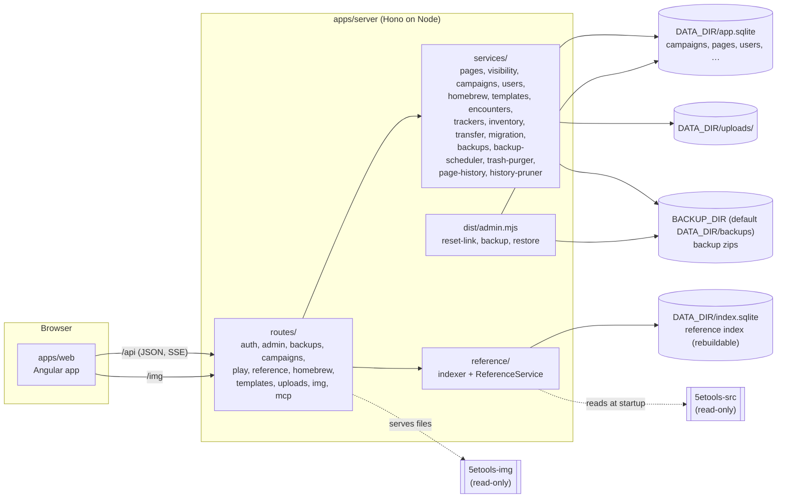

# Architecture

How Critical Notes is put together: the packages, the two databases, how a request is served, how the DM's
secrets stay on the server, and the data model. For setup and use, see the [README](../README.md).

## The pieces

The shared packages hold everything that does not depend on a framework, so the server and the web app use
the same code:

| Package | What it does |
|---|---|
| `packages/fivetools` | Reads 5etools data: the loader, `_copy` inheritance with every `_mod` mode (a safe arithmetic evaluator instead of `eval`), `_versions`, subraces, magic variants, class features, fluff. The edition resolver and reprint groups. Rulesets (2014 and 2024: terminology, encounter difficulty, statblock style). The `{@tag}` tokenizer and the render model for entries. Dice and CR/XP math. Node-only code is in `src/node`. |
| `packages/blocks` | The block document: the registry of block types (zod attribute schemas, content rules), `sanitizeDoc`, the player projection `projectDoc`, `mergePlayerEdit`, text and link extraction, the query DSL. |
| `packages/templates` | Template placeholders (`{{dc: number = 13}}`), typed values, substitution, page template inheritance, the built-in templates. |
| `packages/shared` | The API's types and zod input schemas (used by the server's validators and the web app), page types and facets, the initiative tracker reducer, inventory projections. |
| `apps/server` | The HTTP API on [Hono](https://hono.dev), Drizzle on better-sqlite3, the indexer, image and upload routes, the tracker's event stream, the backup and trash services, and the `admin.mjs` command line. |
| `apps/web` | The Angular app (standalone components, signals, zoneless): the TipTap block editor with Angular node views, the reference browser and renderer, the campaign views, the admin pages. |

## Two databases

- **`app.sqlite`** holds what users create: users and sessions, password reset links, campaigns and members, pages and their facets
  and properties, homebrew, templates, encounters, trackers, inventory. It is the only thing to back up (with
  `uploads/`; the [backup service](#backups-and-restore) does exactly that). Migrations are in `apps/server/drizzle/`; they run at startup.
- **`index.sqlite`** is derived and can be deleted at any time. It holds the reference: every 5etools entity
  after inheritance is resolved, homebrew entities indexed the same way, full-text search (FTS5) over both, and
  the campaign page search with separate DM and player text. The indexer fingerprints the data files and
  re-reads only when something changed (a no-op start takes milliseconds; a full build about 6 seconds).

The Postgres mirror of the app schema (`src/db/schema.pg.ts`, migrations in `drizzle-pg/`) is kept in step by
`test/pg-parity.test.ts`, which applies both migration sets (Postgres in PGlite) and compares the result. The
services use better-sqlite3's synchronous API, so running on Postgres needs an async data layer first. The
reference index stays SQLite either way.

## Serving a request

1. **Security headers** on every response: a Content Security Policy that allows scripts only from the app
   itself, no framing, same-origin resources.
2. **Session:** the cookie holds a random token; the database holds only its SHA-256. Sessions slide forward
   while used.
3. **Origin check** on every write: requests from another origin are refused, and bodies must be JSON or
   multipart (no simple-form CSRF).
4. **Route and access:** campaign routes resolve the user's role (`dm` = owner, `codm`, `player`).
   `requireDm` admits game masters, `requireOwner` only the owner (members, roles, edition change).
5. **Validation** of inputs with the zod schemas from `@cn/shared`.
6. **Service** logic, then **projection** for players (below), then JSON. Event streams (the tracker) are
   not compressed, so updates arrive at once.

## Accounts and administration

- **Users** have `is_admin` and `disabled_at`. A disabled user cannot sign in, their sessions end and their API
  tokens stop working. The last enabled admin cannot be disabled, demoted or deleted.
- **Password reset links** (`password_resets`): the link is `/reset#<token>`. The token is in the URL fragment, so
  it never reaches an access log or a `Referer` header; only its SHA-256 is stored. A link works once, expires after
  24 hours, and a newer link for the same user replaces the older one. Admins make links on the Users page;
  `node admin.mjs reset-link <username>` makes one from the shell when the only admin is locked out.
- **Deleting a user** never deletes campaign content. For each campaign the user owns, the admin transfers it to a
  member or archives it (archiving needs a co-DM; a solo campaign cannot be orphaned).
- **Step-up:** protected admin actions (changing a user, except enabling a non-admin; deleting a user; reset links; backup
  downloads) ask for the admin's own password again. Sign-in, registration, reset and step-up attempts are rate limited in memory
  (`lib/rate-limit.ts`); `TRUST_PROXY=1` makes the limits use `X-Forwarded-For`, and is only safe behind a proxy
  that overwrites it.
- **Audit:** security-relevant events (user deletion, password resets and reset links, backups and their downloads, page
  and template purges and template restores) are one JSON line each on the server's standard output (`lib/audit.ts`). Never a token, link or password.

## Backups and restore

The design is in [design/backup.md](design/backup.md); this is the short version.

- **One zip** holds `manifest.json` (app version, migration level, counts, who started it), a consistent copy of
  `app.sqlite` made with SQLite's online backup while the app runs, `uploads/`, and `checksums.json`. A backup is
  read back and verified before it counts. It is **not encrypted**: it holds password hashes and DM secrets.
- **Who makes one:** an admin on **Admin > Backups** (`/api/admin/backups`, downloads need a one-time ticket
  bought with the admin's password), the shell (`node admin.mjs backup`), or the scheduler
  (`BACKUP_EVERY_HOURS`, off for a bare install, 24 in the shipped `docker-compose.yml`). All three go through
  `BackupService.create`, which holds one lock, so only one backup runs at a time. Retention keeps the newest
  `BACKUP_KEEP` (default 7); backups made from the web page are protected for 7 days.
- **Restore is command line only** (`node admin.mjs restore <file> [--check|--yes]`). It stops if the server is
  running, checks the zip, upgrades an older database, moves the live data to `pre-restore-<time>/`, installs the
  backup, and rolls back on failure. A `.restore-in-progress` marker in `DATA_DIR` makes a crashed restore
  resumable and keeps the server from starting on half-swapped files. A backup from a newer version is refused.
  It signs everyone out and revokes API tokens and invites. The search index is rebuilt on the next start.
- **Tested in CI:** `pnpm drill` (`apps/server/scripts/restore-drill.mjs`) backs up a running server, wipes the data,
  restores, starts the server again and checks users, campaign, page, image and login over HTTP; `schema-allowlist.test.ts` fails when a new migration uses something a restore has not
  been reviewed for.
- **Shutdown:** the server always handles SIGTERM and SIGINT and waits up to 8 seconds for a running backup; the
  shipped compose file sets `init: true` and `stop_grace_period: 15s` for this.

## Trash

Deleting a page sets `deleted_at` on it and its subpages. Deleted pages disappear from the tree, search, queries
and backlinks (the page index drops them), and Restore rebuilds the derived rows, so links, backlinks and search come
back. Templates and homebrew use the same soft delete. `trash-purger` removes pages and templates deleted more than
30 days ago (`TRASH_RETENTION_DAYS`, first about a minute after start and then daily); it waits while a backup or restore
runs. **Delete permanently** is `DELETE .../purge`; it is never on the MCP allowlist.

## Page history

Every content write of a page (`PageService.create` and `update`, which also serve the player edit, template sync and apply,
edition migration, import, the tracker's end-of-combat hit-point sync and the MCP tools) leaves a full snapshot in
`page_revisions`, in the same transaction as the write: title, type, body (with DM-only blocks), details and properties, who
(`web`, `player` or `mcp` with the token id), and why (`cause`). Design and reasons: [design/page-history.md](design/page-history.md).

- **Folding:** saves by the same author and source within `HISTORY_COALESCE_MINUTES` (default 2) become one row that keeps the
  time of its first save. MCP calls, restores, template, migration and tracker writes are never folded.
- **Baseline:** the first recorded write of an older page also stores the state it overwrote (`cause = baseline`, source
  `system`), decided by comparing content hashes, so history is never silently missing the overwritten state.
- **Retention** (`HistoryPruner`, daily, waits for backups and restores): every row for `HISTORY_KEEP_ALL_DAYS` (30), then one per
  page per day, one per month after `HISTORY_MONTHLY_AFTER_DAYS` (365); a page over `HISTORY_MAX_PER_PAGE` (200) rows and a campaign
  over `HISTORY_MAX_MB_PER_CAMPAIGN` (500, soft) are thinned early, never inside the 30-day window. The newest and the oldest row
  of a page are never pruned. Purging a page deletes its history first, in short transactions. There is no switch to turn history off.
- **Who reads it:** only `PageHistoryService`, and only for game masters (the endpoints `GET /pages/:pid/history`, `GET /pages/:pid/history/:rev` and `POST /pages/:pid/history/:rev/restore`, task N1.3, check the GM role in a middleware before anything else). Players never see history,
  and history is not exported with a campaign.
- **Backups:** history lives in `app.sqlite`, so backups grow with it. Near-identical page copies deflate at about 50:1, so the
  restore reader's ratio limit for the database is 200:1 (it was 50:1).

## What players can see

Every response that carries campaign content goes through the player projection when the viewer is a player.
There is no client-side hiding: the browser of a player never receives what they may not see.

- **Pages:** `VisibilityService.visiblePageIds` = pages shared with everyone, `selected` pages that list the
  player, and the player's own characters. Everything else is absent from the tree, lists, search, queries,
  backlinks and links (a link to a hidden page becomes plain text).
- **Blocks:** `projectDoc` drops DM-only blocks and unrevealed secrets with everything inside them.
- **Fields:** DM-only properties and facet fields (`FACET_DM_ONLY_FIELDS`) are left out.
- **Combat:** the player view of a tracker has no hidden creatures, no notes or AC, and health words instead
  of hit points for anything but player characters.
- **Inventory:** unidentified items show as "Unidentified item"; characters the player can't see, and their
  coins, are absent.
- **Edits:** a player may change only their own character. `mergePlayerEdit` puts the blocks they never
  received back in place, so their save cannot delete the DM's notes.

`test/visibility.test.ts` seeds "SENTINEL" strings into every kind of hidden content and requests more than
40 player-reachable endpoints, failing if any response contains one; the browser test `e2e/players.spec.ts`
does the same for every response a real player's browser receives. A new endpoint that returns campaign
content needs both: the projection, and a sentinel in the seed.

## AI assistants (MCP)

`/mcp` is a Streamable HTTP endpoint (`@modelcontextprotocol/server`, a fresh server per request) for AI
assistants. It is the only place that accepts a bearer token: personal API tokens (`api_tokens`, only a
SHA-256 stored), read only or read and write, made and revoked on the Account page.

- **Tools call the REST API in-process** (`app.request`) as the token's user (`mcp/api.ts`). The call
  carries a module-private symbol in the request env, which `sessionMiddleware` turns into that user; nothing
  arriving over HTTP can set it. Every role check, validation and player projection is therefore the one the
  web app gets. An allowlist limits the calls to the ones the tools need: tokens never reach accounts,
  tokens, invites, members, imports, exports or the edition change. Read tokens get only the read tools, and
  the middleware refuses their writes anyway.
- **Page text as Markdown** (`@cn/blocks/markdown`): `docToMarkdown` writes a Markdown dialect (`:::secret`,
  `:::dm`, `{@tags}`, `[[links]]`…); blocks it can't express become `<!-- cn:block <id> … -->` lines.
  `markdownToDoc` reads it back and `reconcile`s it with the version it was made from (longest common
  subsequence on each block's content, level by level), so unchanged blocks are kept exactly and edited ones
  keep their ids. For a player that version is their projection, and kept ids let `mergePlayerEdit` put the
  hidden blocks back in place.
- The sentinel crawl calls every read tool as a player too.

## The web app on a phone

Below Tailwind's `lg` breakpoint (1024 px) the app shell switches to a compact 56 px header (48 px in short landscape)
with a menu and a campaign drawer; from `lg` the original inline header is unchanged. The shell is the same
markup, switched with `max-lg:` and `lg:` utilities. Touch devices get 44 px targets and 16 px form text through the
`touch:` variant and the shared `.cn-input` and `.cn-btn` classes in `styles.css`; `LayoutService` holds the drawer
state and whether the window counts as a phone. The design is [design/phone-layout.md](design/phone-layout.md), the
audit that led to it [qa/phone-audit.md](qa/phone-audit.md). Only player flows were re-laid-out; the DM's prep
screens stay desktop-first. The Playwright project `phone` (Chrome emulation of 390 x 844 with touch, not a real device; its own server on port 3211) runs the
player specs and checks for sideways scroll, header height and target sizes.

## Editions

A campaign's policy is `{ruleset, crossEdition, sourceOverrides}`. The edition of a source comes from the
`5etools-utils` source lists, then the publication date; an entity can override it (`edition: "classic"`).
Entities that reprint each other (`reprintedAs`) form a reprint group: lists and search show one member per
group (the campaign's edition first), and the others stay reachable. Code outside `ruleset/` and `edition/`
never compares edition strings (an ESLint rule enforces it); it asks the `Ruleset` instead.

## The block editor

Page bodies are ProseMirror JSON in our own schema (`schemaVersion: 1`). The server sanitizes every saved
body against the registry: unknown blocks are kept as `unknownBlock` instead of being lost, and only http(s)
and mailto links survive. The web app renders custom blocks as Angular components inside TipTap; read-only
views (`cn-block-view`) render the same JSON without the editor. No user content is ever inserted as HTML (a
lint check forbids `innerHTML` and `bypassSecurityTrust*`).

## Uploads and images

Uploads are checked by their bytes (PNG, JPEG, GIF, WebP; never SVG), then decoded and re-encoded with sharp,
which applies the orientation and drops all metadata (a phone photo's location included), and stored with a
400 px WebP preview. They are served only to members of their campaign. 5etools images are served from the
read-only clone under `/img` after the path is resolved and checked (no `..`, no symlinks out, image types
only).

## Deployment

`pnpm build` bundles the server with esbuild into `apps/server/dist/main.mjs` and the command line into
`dist/admin.mjs`; the bundle bakes in the root `package.json` version, which `/api/health` (public, returns only `ok`
and the version) and every backup report. Native modules (better-sqlite3,
argon2, sharp) and `5etools-utils` stay external; `dist/package.json` lists them. The Docker image builds the
bundle and the web app, installs only those packages, and runs as the `node` user with the 5etools clones
mounted read-only. A pushed tag `vX.Y.Z` runs `.github/workflows/release.yml`, which gates the commit, builds the
image for `linux/amd64` and `linux/arm64`, pushes it to `ghcr.io/merilairon/critical-notes` and creates the GitHub
Release ([RELEASE.md](RELEASE.md)); `.github/workflows/ci.yml` runs the gate and the restore drill on every pull
request and push to `main`. Database migrations run when the server starts and only go forward.

## Data model

The app database (`apps/server/src/db/schema.ts`). Timestamps are epoch milliseconds; JSON columns are text in
SQLite and `jsonb` in Postgres. Derived tables (`page_links`, `entity_references`, `template_usage`) are
rewritten whenever a page is saved.

```mermaid
erDiagram
  users ||--o{ sessions : "signs in"
  users ||--o{ campaign_members : joins
  campaigns ||--o{ campaign_members : has
  campaigns ||--o{ campaign_invites : "invites with"
  campaigns ||--o{ campaign_source_overrides : "turns sources on/off"
  campaigns ||--o{ campaign_migrations : "logs edition changes"
  campaigns ||--o{ pages : contains
  pages ||--o{ pages : "parent of"
  pages ||--o{ page_tags : tagged
  pages ||--o{ page_viewers : "shared with"
  users ||--o{ page_viewers : sees
  pages ||--o| npc_facets : "NPC details"
  pages ||--o| location_facets : "location details"
  pages ||--o| session_facets : "session details"
  pages ||--o| quest_facets : "quest details"
  pages ||--o| faction_facets : "faction details"
  pages ||--o| character_facets : "character sheet"
  pages ||--o| item_facets : "item details"
  users ||--o{ character_facets : plays
  campaigns ||--o{ property_defs : defines
  property_defs ||--o{ page_property_values : "values of"
  pages ||--o{ page_property_values : has
  pages ||--o{ page_links : "links to (derived)"
  pages ||--o{ entity_references : "uses rules (derived)"
  campaigns ||--o{ uploads : stores
  users ||--o{ homebrew_sources : owns
  campaigns ||--o| homebrew_sources : "campaign-only source"
  homebrew_sources ||--o{ homebrew_source_shares : "shared with"
  campaigns ||--o{ homebrew_source_shares : uses
  homebrew_sources ||--o{ homebrew_entities : contains
  homebrew_entities ||--o{ homebrew_revisions : "history of"
  pages ||--o{ page_revisions : "history of (full copies)"
  campaigns ||--o{ page_revisions : "scopes"
  templates ||--o{ template_versions : "versions of"
  templates ||--o{ template_usage : "used in (derived)"
  pages ||--o{ template_usage : uses
  campaigns ||--o{ templates : "campaign templates"
  campaigns ||--o{ campaign_template_defaults : "default per page type"
  templates ||--o{ campaign_template_defaults : "is default"
  campaigns ||--o{ encounters : plans
  encounters ||--o{ trackers : "runs as"
  campaigns ||--o{ trackers : has
  campaigns ||--o{ inventory_items : holds
  pages ||--o{ inventory_items : "owned by (PC)"
  campaigns ||--o{ currencies : "coins per owner"
  pages ||--o{ loot_awards : "loot handed out"
  users ||--o{ api_tokens : "AI assistant tokens"
  users ||--o{ password_resets : "reset links"

  users {
    text id PK
    text username UK
    text display_name
    text password_hash "argon2id"
    bool is_admin
    int disabled_at "null = enabled"
  }
  password_resets {
    text id PK
    text user_id FK
    text token_hash UK "sha256"
    text created_by FK "null from the CLI"
    int expires_at
    int used_at
  }
  campaigns {
    text id PK
    text name
    text ruleset "2014 or 2024"
    bool cross_edition
    json house_rules
    text status
  }
  campaign_members {
    text campaign_id PK
    text user_id PK
    text role "dm, codm, player"
  }
  campaign_invites {
    text id PK
    text token_hash UK
    text role
    int expires_at
    int max_uses
    int uses
  }
  pages {
    text id PK
    text campaign_id FK
    text parent_id FK
    text sort_key "fractional index"
    text type
    text title
    text visibility "dm, all, selected"
    json body "block document"
    int revision "optimistic concurrency"
    int deleted_at
  }
  character_facets {
    text page_id PK
    text player_user_id FK
    json classes
    int hp_max
    int hp_current
  }
  property_defs {
    text id PK
    text campaign_id FK
    text key
    text type
    bool dm_only
  }
  homebrew_sources {
    text id PK
    text json_id "5etools source key"
    text edition
    text scope "private, campaigns, instance, campaign"
  }
  homebrew_entities {
    text id PK
    text source_id FK
    text entity_type
    text name
    json data "5etools format, may _copy"
    int current_revision
  }
  templates {
    text id PK
    text kind "block or page"
    text scope "global, user, campaign"
    text builtin_key UK
    int version
    json definition
    int deleted_at "trash, purged after 30 days"
  }
  encounters {
    text id PK
    text campaign_id FK
    json creatures
    json party
  }
  trackers {
    text id PK
    text encounter_id FK
    text status
    json state "tracker reducer state"
    int revision
  }
  inventory_items {
    text id PK
    text owner_page_id FK "null: party stash"
    text item_uid
    int quantity
    bool attuned
    bool identified
  }
  api_tokens {
    text id PK
    text user_id FK
    text token_hash UK "sha256"
    text scope "read or write"
    int expires_at
    int revoked_at
  }
  uploads {
    text id PK
    text campaign_id FK
    text mime
    text sha256
    int width
    int height
  }
```

