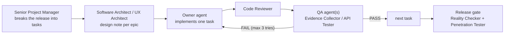

# Critical Notes: Project Plan

| | |
|---|---|
| Status | Ready to run: Release 1.0 tasks are broken down; 1.1 is broken down; 1.2 and later are assigned but not yet broken down |
| Date | 2026-10-13 |
| Specification | [PRD.md](PRD.md) (what and why). This file is the task list (who and how). |
| Engineering state | [STATUS.md](STATUS.md) · [ARCHITECTURE.md](ARCHITECTURE.md) · [PLAN.md](PLAN.md) |
| Agents | From [msitarzewski/agency-agents](https://github.com/msitarzewski/agency-agents) (see §2 and §9) |

## 1. Specification summary

**From the PRD (§1, §11):** "What separates it from a public 1.0 is not more features, but the basics a self-hosted product needs to be trusted with years of campaign notes: account recovery, backups, undo for deletions, a license, and a release process."

| Release | Theme | PRD items | In this file |
|---|---|---|---|
| **1.0** | Trustworthy to self-host | M1 License, M2 Accounts, M3 Backup, M4 Trash, M5 Release process, M6 Phone-width | 40 tasks, 9 waves (§5) |
| **1.1** | Prep and play loop | N1 Page history, N3 Reveal to players, I1 Keep hidden links, I3 Tracker additions, I2 Query views | 21 tasks, 5 waves (§6) |
| **1.2** | Stay in sync | N2, N4, I4, I5, I10 | Assigned, broken down when scheduled (§7) |
| **Later** | Grow | N5–N17, I6–I18 | Assigned, broken down when scheduled (§7) |

**Technical stack (exact):** pnpm 11 monorepo, TypeScript 6.0.3, Node 24. Server: Hono, Drizzle ORM on better-sqlite3 (Postgres mirror schema), zod 4, `@modelcontextprotocol/server` 2.3.1. Web: Angular 22 (standalone, signals, zoneless, `httpResource`), Tailwind v4, TipTap v3. Tests: Vitest (unit/API), Playwright (`e2e/`, system Chrome, real 5etools data). Delivery: esbuild server bundle, Docker (non-root), docker-compose.

## 2. The team

Agents are referred to by their name in the repository; the file is in brackets. A task names one **owner** (does the work) and one or more **QA** agents (verify it). Decisions marked **Owner (human)** belong to the project owner, not to an agent.

### Coordination
| Agent | Role in this project |
|---|---|
| **Agents Orchestrator** (`specialized/agents-orchestrator`) | Runs the pipeline (§3): hands each task to its owner, then to QA, retries up to 3 times, escalates. Keeps the checkboxes in this file current. |
| **Senior Project Manager** (`project-management/project-manager-senior`) | Owns this file: breaks the next release into tasks, keeps scope to the PRD, re-plans when tasks fail. |
| **Product Manager** (`product/product-manager`) | Owns the PRD; accepts or rejects scope changes; prepares the owner's decisions (§8). |
| **Sprint Prioritizer** (`product/product-sprint-prioritizer`) | Re-ranks the backlog between releases using feedback and the PRD's value/effort method. |

### Design and research
| Agent | Role |
|---|---|
| **UX Architect** (`design/design-ux-architect`) | The "ArchitectUX" step for each epic with UI: flows, layouts, Tailwind patterns developers follow. |
| **UI Designer** (`design/design-ui-designer`) | Visual consistency of new screens (Account, Admin, Trash, History) in light and dark themes. |
| **UX Researcher** (`design/design-ux-researcher`) | Runs the "first evening" tests (PRD §4) and validates demand before big bets (N13). |
| **Game Designer** (`game-development/game-designer`) | D&D rules expert for combat and generators (I3, N4): exact 2014/2024 rules, what players may see. |
| **Narrative Designer** (`game-development/narrative-designer`) | Session recaps and story structure (N12), the "table moment" of reveals (N3). |

### Engineering
| Agent | Role |
|---|---|
| **Software Architect** (`engineering/engineering-software-architect`) | Design notes before code for cross-cutting work (page history, events, data model changes). |
| **Backend Architect** (`engineering/engineering-backend-architect`) | Server work: Hono routes, services, Drizzle schema, migrations, reducers in `@cn/shared`. |
| **Frontend Developer** (`engineering/engineering-frontend-developer`) | Angular UI: pages, components, guards, editor views. |
| **Identity & Access Engineer** (`engineering/engineering-identity-access-engineer`) | Accounts, password reset, admin, sessions, later OAuth for MCP (M2, N5). |
| **Database Reliability Engineer** (`engineering/engineering-database-reliability-engineer`) | Backups, restore, retention, migrations safety, later Postgres at run time (M3, N14). |
| **DevOps Automator** (`engineering/engineering-devops-automator`) | CI, release workflow, Docker image publishing (M5). |
| **Git Workflow Master** (`engineering/engineering-git-workflow-master`) | Branching, conventional commits, tags, merging parallel work (M5). |
| **Realtime Collaboration Engineer** (`engineering/engineering-realtime-collaboration-engineer`) | Server-sent events, live reveals, shared dice, later co-editing (N3, N9, N10). |
| **Minimal Change Engineer** (`engineering/engineering-minimal-change-engineer`) | Narrow bug fixes, starting with the hidden-links data loss (I1). |
| **MCP Builder** (`specialized/specialized-mcp-builder`) | The `/mcp` server: new tools when features land (history, trash), MCP improvements (I16, N12). |
| **Knowledge Graph Engineer** (`engineering/engineering-knowledge-graph-engineer`) | Relationship graph model (N8). |
| **Data Visualization Engineer** (`engineering/engineering-data-visualization-engineer`) | Graph and timeline rendering (N7, N8). |
| **Internationalization Engineer** (`engineering/engineering-i18n-engineer`) | Translations (N16). |

### Quality, security, docs and legal
| Agent | Role |
|---|---|
| **Code Reviewer** (`engineering/engineering-code-reviewer`) | Reviews every task's diff before QA. |
| **Evidence Collector** (`testing/testing-evidence-collector`) | Per-task QA in the browser with screenshots; PASS/FAIL with evidence. |
| **API Tester** (`testing/testing-api-tester`) | Per-task QA for endpoints: status codes, permissions, validation, error shapes. |
| **Test Automation Engineer** (`testing/testing-test-automation-engineer`) | Writes and maintains Playwright specs (`e2e/`); keeps them free of flakes. |
| **Accessibility Auditor** (`testing/testing-accessibility-auditor`) | WCAG checks on every new screen; the full audit later (I11). |
| **Performance Benchmarker** (`testing/testing-performance-benchmarker`) | "Fast at the table" budgets: search, queries, tracker (I2). |
| **Reality Checker** (`testing/testing-reality-checker`) | Release gate: certifies a release against the PRD's "Done when" criteria; defaults to NEEDS WORK. |
| **Security Architect** (`security/security-architect`) | Threat models for accounts, backups, events and OAuth before they are built. |
| **Application Security Engineer** (`security/security-appsec-engineer`) | Security review of every change touching auth, visibility or data export; keeps the sentinel tests complete. |
| **Penetration Tester** (`security/security-penetration-tester`) | Authorized test of a running 1.0 candidate (local instance only). |
| **Technical Writer** (`engineering/engineering-technical-writer`) | README, CHANGELOG, upgrade notes, admin and backup guides, keeping STATUS/ARCHITECTURE current. |
| **Developer Advocate** (`specialized/specialized-developer-advocate`) | CONTRIBUTING, issue templates, the public launch of 1.0. |
| **Legal Compliance Checker** (`support/support-legal-compliance-checker`) | License options and the content position (M1, N11). Advice to the owner, not legal counsel. |

**Not used, and why:** Senior Developer (Laravel/FluxUI specialist; this is Angular/Hono), Mobile App Builder (native apps are a PRD non-goal; phone support is responsive web), Search Relevance Engineer (built for Elasticsearch/OpenSearch; search here is SQLite FTS5, owned by the Backend Architect), Project Shepherd (overlaps the Orchestrator). The project's own `project-assistant` agent (`.claude/agents/`) stays available for ad-hoc work.

## 3. How work flows



1. **One task at a time per agent.** The Orchestrator gives the owner exactly one task, with its acceptance criteria and the project rules (§4).
2. **Review, then QA.** Code Reviewer first; then the task's QA agents. QA answers PASS or FAIL with evidence (test output, screenshots, request/response pairs).
3. **Retries.** A FAIL goes back to the owner with the QA feedback. After 3 failures the task is marked blocked and escalated to the Senior Project Manager (re-plan) or the owner (decision).
4. **Parallel work.** Tasks in the same wave (§5.7, §6.6) may run in parallel, each in its own git worktree. Tasks that change `apps/server/src/db/schema*.ts`, `app.routes.ts` or `app.ts` are merged one at a time by the Git Workflow Master.
5. **Checkboxes.** When a task passes QA, the Orchestrator ticks it (`### [x]`) and adds one line: `**Done:** <date>, QA <agent>: PASS`.
6. **Releases.** A release ships only after every task is ticked, the gate tasks pass, and the owner approves.

**Starting the pipeline.** "Activate Agents Orchestrator. Spec: `docs/PRD.md`. Task list: `docs/PROJECT.md`. Run Release 1.0, wave by wave."

## 4. Rules every agent follows

These come from the codebase and are not negotiable; QA fails a task that breaks one.

- [ ] **Gate:** `pnpm -s typecheck && pnpm -s lint && pnpm -s test` passes. Tasks with UI also pass `pnpm e2e` (needs the local 5etools clone).
- [ ] **Players never receive DM content.** Any endpoint returning campaign content projects it for players, and gets a sentinel string in `apps/server/test/visibility.test.ts`. MCP read tools are crawled too.
- [ ] **GM-only UI:** new GM-only routes use `canActivate: [gmGuard]`; the server checks regardless.
- [ ] **Schema changes** go into both `apps/server/src/db/schema.ts` and `schema.pg.ts`, then `pnpm --filter @cn/server db:generate`; the parity test must pass.
- [ ] **No edition string comparisons** (`'2014'`, `'2024'`, `'classic'`, `'one'`) outside `packages/fivetools/src/ruleset` and `edition` (ESLint enforces it).
- [ ] **No raw HTML:** no `innerHTML`, no `bypassSecurityTrust*` (lint guard).
- [ ] **Angular:** standalone, signals, OnPush, zoneless; an `effect` that calls async code wraps it in `untracked`.
- [ ] **Data:** never commit or upload `5etools-data/`, `var/`, test traces or screenshots containing rules text.
- [ ] **Git:** conventional commits; **never add Co-Authored-By lines**; no commit or push without the owner's go-ahead for that release.
- [ ] **Docs:** behaviour changes update `docs/STATUS.md`; departures from the PRD are logged in `docs/PLAN.md` (deviations) and raised with the Product Manager.
- [ ] **Scope:** build what the task says. Ideas go to the Product Manager, not into the diff.

## 5. Release 1.0: Trustworthy to self-host

### 5.1 Epic M1: License

### [ ] Task M1.1: License options brief
**Owner**: Legal Compliance Checker · **QA**: Product Manager
**Description**: Compare MIT, Apache-2.0 and AGPL-3.0 for a self-hosted app (hosted forks, contributions, compatibility with dependencies). Review the content notice in README "Licensing" and DATA_NOTES §9 (5etools code MIT, WotC content and art, SRD 5.1/5.2 CC-BY-4.0, bring your own data).
**Acceptance Criteria**:
- `docs/legal/license-options.md` with a recommendation, trade-offs, and a dependency license check (`pnpm licenses list`)
- [THIRD_PARTY_NOTICES.md](../THIRD_PARTY_NOTICES.md) reviewed; a generated file with the full license text of every package in the server bundle (and any Apache-2.0 NOTICE files) is added to the build and the image
- Every claim in the README's licensing section marked correct or corrected
- States clearly that it is not legal advice
**Reference**: PRD §8 M1, §12

### [ ] Task M1.2: Decide the license
**Owner**: **Owner (human)**, prepared by Product Manager · **QA**: none
**Description**: Choose the license from the brief. Record it in §8 (decision log).
**Depends on**: M1.1

### [ ] Task M1.3: Publish the license
**Owner**: Technical Writer · **QA**: Code Reviewer
**Description**: Add `LICENSE`; set `"license"` in every `package.json` (root, `apps/*`, `packages/*`); update the README licensing section.
**Acceptance Criteria**:
- `LICENSE` matches the decision; all `package.json` files agree
- README states the license and keeps the content notice
**Files**: `LICENSE`, `package.json` (×7), `README.md`
**Depends on**: M1.2

### [ ] Task M1.4: Contributor files
**Owner**: Developer Advocate · **QA**: Technical Writer
**Description**: `CONTRIBUTING.md` (setup, data clone, gate, the rules in §4), `SECURITY.md` (private reporting), `.github/ISSUE_TEMPLATE/` (bug, feature), `.github/pull_request_template.md` (gate checklist, sentinel rule, no co-author lines).
**Acceptance Criteria**:
- A new contributor can set up and run the gate from CONTRIBUTING alone
- The bug template asks for version, install method and steps; never for rules content
**Depends on**: M1.3

### 5.2 Epic M2: Account recovery and user administration

### [ ] Task M2.1: Accounts design and threat model
**Owner**: Identity & Access Engineer · **QA**: Security Architect
**Description**: Design without email: admin-issued one-time reset links (hashed like invite tokens, 24 h expiry, single use), disabling a user (ends sessions and API tokens), deleting a user (what happens to campaigns they own: transfer to a chosen member or archive), the last-admin rule, a command-line reset for a locked-out admin.
**Acceptance Criteria**:
- `docs/design/accounts.md` with flows, data model changes, endpoints and threats (enumeration, token theft, privilege escalation) with mitigations
- Reviewed against `apps/server/src/auth/session.ts` and `routes/auth.ts` (the `/password` route already exists)
**Reference**: PRD §8 M2

### [ ] Task M2.2: Schema for accounts
**Owner**: Backend Architect · **QA**: Database Reliability Engineer
**Description**: Add `users.disabled_at` and a `password_resets` table (id, user_id, token_hash, created_by, expires_at, used_at) to both schemas; generate migrations.
**Acceptance Criteria**:
- Migrations for SQLite and Postgres generated; pg parity test passes
- Existing data migrates without loss (test on a copy of a populated `var/`)
**Files**: `apps/server/src/db/schema.ts`, `schema.pg.ts`, `drizzle/`, `drizzle-pg/`
**Depends on**: M2.1

### [ ] Task M2.3: Self-service account endpoints
**Owner**: Identity & Access Engineer · **QA**: API Tester
**Description**: `PATCH /api/auth/me` (display name); make the existing password change end the user's other sessions; disabled users can't sign in and their sessions and API tokens stop working (`ApiTokenService.verify`).
**Acceptance Criteria**:
- Changing the password signs out other browsers but not the current one
- A disabled user gets 401 everywhere, including `/mcp`
**Files**: `apps/server/src/routes/auth.ts`, `auth/session.ts`, `services/api-tokens.ts`
**Depends on**: M2.2

### [ ] Task M2.4: Admin user endpoints
**Owner**: Backend Architect · **QA**: API Tester, Application Security Engineer
**Description**: `requireAdmin` routes under `/api/admin/users`: list; create a reset link (shown once); disable/enable; grant/revoke admin; delete with the ownership rule from M2.1. Never remove the last admin; an admin can't disable themselves.
**Acceptance Criteria**:
- Non-admins get 403 on every route; the last-admin rule holds under every path
- Reset tokens are stored hashed; the link is in the response once
- Not reachable from the MCP API allowlist (`apps/server/src/mcp/api.ts`)
**Files**: new `apps/server/src/routes/admin.ts`, `services/users.ts`, `app.ts`
**Depends on**: M2.2

### [ ] Task M2.5: Password reset by link
**Owner**: Identity & Access Engineer · **QA**: API Tester
**Description**: `GET /api/auth/reset/:token` (valid or not, for whom) and `POST /api/auth/reset/:token` (new password; single use; rate limited like login).
**Acceptance Criteria**:
- Expired, used and unknown tokens answer alike (no enumeration)
- After a reset, all of that user's sessions end
**Depends on**: M2.4

### [ ] Task M2.6: Command-line admin reset
**Owner**: Backend Architect · **QA**: DevOps Automator
**Description**: `node dist/admin.mjs reset-link <username>` prints a reset link; works in Docker (`docker compose exec app node admin.mjs …`). Add the entry to `apps/server/scripts/build.mjs`.
**Acceptance Criteria**:
- Works against a running instance's database (SQLite WAL) and in the container
- Documented in the README
**Depends on**: M2.5

### [ ] Task M2.7: Account page: profile and password
**Owner**: Frontend Developer · **QA**: Evidence Collector, Accessibility Auditor
**Description**: Add display name and password sections to `apps/web/src/app/account/account-page.ts` (current password, new password twice).
**Acceptance Criteria**:
- Errors shown inline; success confirmed; keyboard and screen-reader usable
- Unit spec next to the component
**Depends on**: M2.3

### [ ] Task M2.8: Admin: users page
**Owner**: Frontend Developer · **QA**: Evidence Collector
**Description**: `/admin/users` (admin guard): list with role badges; "Reset link" (shown once with copy); disable/enable; admin toggle; delete with the ownership choice. Header link for admins only.
**Acceptance Criteria**:
- Non-admins can't reach the route (guard) and don't see the link
- Destructive actions confirm first
**Files**: new `apps/web/src/app/admin/`, `app.routes.ts`, `app.html`
**Depends on**: M2.4 · **Design**: UX Architect (one screen sketch before the task)

### [ ] Task M2.9: Reset page
**Owner**: Frontend Developer · **QA**: Evidence Collector
**Description**: `/reset/:token` outside the auth guard: shows whose account, sets the new password, signs in.
**Depends on**: M2.5

### [ ] Task M2.10: Account tests
**Owner**: Test Automation Engineer · **QA**: Reality Checker
**Description**: `e2e/admin.spec.ts`: admin creates a reset link → user resets → signs in; disabled user can't sign in; MCP token of a disabled user fails.
**Acceptance Criteria**: passes in `pnpm e2e` and against the Docker image (`E2E_BASE`)
**Depends on**: M2.7, M2.8, M2.9

### 5.3 Epic M3: Instance backup and restore

### [ ] Task M3.1: Backup design
**Owner**: Database Reliability Engineer · **QA**: Security Architect
**Description**: Format: one zip with `app.sqlite` (SQLite online backup, consistent while the server writes), `uploads/`, and `manifest.json` (app version, migration level, created at). `index.sqlite` is excluded (rebuilt on start). Restore rules (only into a stopped instance; refuse a backup from a newer migration level). Retention. Backups contain password hashes and token hashes: who may download them.
**Acceptance Criteria**: `docs/design/backup.md` approved; threat notes on backup files
**Reference**: PRD §8 M3

### [ ] Task M3.2: Backup service
**Owner**: Database Reliability Engineer · **QA**: API Tester
**Description**: `BackupService.create()` writes `DATA_DIR/backups/backup-<timestamp>.zip` (better-sqlite3 `backup()`, `fflate`); `list()`; `prune(keep)`.
**Acceptance Criteria**:
- A backup taken while a test writes pages restores to identical data (automated test)
- Large uploads folders stream without loading everything into memory
**Files**: new `apps/server/src/services/backups.ts`, tests
**Depends on**: M3.1

### [ ] Task M3.3: Backup and restore commands
**Owner**: Database Reliability Engineer · **QA**: DevOps Automator
**Description**: `node dist/admin.mjs backup` and `restore <file>` (refuses while the server runs; checks the manifest).
**Acceptance Criteria**: a restore drill (backup → wipe → restore → start) passes in CI
**Depends on**: M3.2, M2.6 (shares `admin.mjs`)

### [ ] Task M3.4: Admin backup endpoints and page
**Owner**: Backend Architect (endpoints), Frontend Developer (page) · **QA**: API Tester, Evidence Collector
**Description**: `POST/GET /api/admin/backups`, `GET /api/admin/backups/:name` (download); `/admin/backups` page with "Back up now", list, download.
**Acceptance Criteria**: admin only; file names validated (no path traversal); not in the MCP allowlist
**Depends on**: M3.2, M2.8

### [ ] Task M3.5 (stretch): Scheduled backups
**Owner**: Database Reliability Engineer · **QA**: API Tester
**Description**: `BACKUP_EVERY_HOURS` and `BACKUP_KEEP` settings; runs in the server process.
**Depends on**: M3.2

### [ ] Task M3.6: Backup guide
**Owner**: Technical Writer · **QA**: Database Reliability Engineer
**Description**: README section: what's in a backup, how to back up and restore with and without Docker, copying backups off the machine.
**Depends on**: M3.3, M3.4

### 5.4 Epic M4: Trash

### [ ] Task M4.1: Trash endpoints
**Owner**: Backend Architect · **QA**: API Tester, Application Security Engineer
**Description**: `GET /api/campaigns/:cid/trash` (deleted page trees: root, subpage count, deleted at), `DELETE /pages/:pid/purge` (permanent), purge of items older than 30 days at start and daily. `POST /pages/:pid/restore` already exists (`PageService.restore`).
**Acceptance Criteria**:
- GM only; players get 403; the sentinel crawl includes the trash route
- Purge removes derived rows (links, references, search) and upload references stay valid
**Files**: `apps/server/src/routes/campaigns.ts`, `services/pages.ts`, `test/visibility.test.ts`
**Reference**: PRD §8 M4

### [ ] Task M4.2: Templates restore
**Owner**: Backend Architect · **QA**: API Tester
**Description**: Templates are soft-deleted already (`deletedAt`); add list-deleted and restore for the user's own and campaign templates.
**Depends on**: M4.1

### [ ] Task M4.3: Trash view and undo
**Owner**: Frontend Developer · **QA**: Evidence Collector
**Description**: Campaign "Trash" view (GM only) with Restore and Delete permanently; a toast "Deleted · Undo" after deleting a page.
**Acceptance Criteria**: restoring brings back subpages, backlinks and search results (checked in the browser)
**Files**: `apps/web/src/app/campaign/` (new `trash.ts`), `campaign-shell.ts`, `page-editor.ts`
**Depends on**: M4.1 · **Design**: UX Architect

### [ ] Task M4.4: MCP tools for the trash
**Owner**: MCP Builder · **QA**: API Tester
**Description**: `list_trash` (read) for the assistant, so it can find what it deleted; allowlist the route.
**Depends on**: M4.1

### [ ] Task M4.5: Trash tests
**Owner**: Test Automation Engineer · **QA**: Reality Checker
**Description**: `e2e/trash.spec.ts`: delete a page with a subpage → restore from the trash → content, backlinks and search intact; undo toast works.
**Depends on**: M4.3

### 5.5 Epic M5: Release process

### [ ] Task M5.1: Repository and branching
**Owner**: Git Workflow Master · **QA**: **Owner (human)**
**Description**: The first commit (nothing is committed yet), the remote (decision in §8), `main` plus short-lived branches, conventional commits, tags `vX.Y.Z`. Check `.gitignore` keeps `5etools-data/`, `var/`, test output and `e2e/.auth/` out.
**Acceptance Criteria**: history starts clean; no rules content, no secrets, no co-author lines in any commit
**Depends on**: M1.3 (license in the first public commit)

### [ ] Task M5.2: CI for the gate
**Owner**: DevOps Automator · **QA**: Code Reviewer
**Description**: GitHub Actions: pnpm install (cached), typecheck, lint, unit/API tests (synthetic fixture), build. Runs on every push and pull request.
**Acceptance Criteria**: green on `main`; under 10 minutes
**Files**: `.github/workflows/ci.yml`
**Depends on**: M5.1

### [ ] Task M5.3: Browser tests in CI without leaking data
**Owner**: DevOps Automator · **QA**: Application Security Engineer
**Description**: A job for `pnpm e2e` on a self-hosted runner that has a local 5etools clone. Traces and screenshots are not uploaded as artifacts (they contain rules text).
**Acceptance Criteria**: runs on pull requests from the main repository only; no data leaves the runner
**Depends on**: M5.2, decision D4 (§8)

### [ ] Task M5.4: Version in the app
**Owner**: Backend Architect · **QA**: API Tester
**Description**: One version source (root `package.json`), returned by `/api/health` and shown in the app footer or Account page; written into backups' manifests.
**Depends on**: M5.1

### [ ] Task M5.5: Release workflow
**Owner**: DevOps Automator · **QA**: Reality Checker
**Description**: On tag `v*`: build and push the Docker image to GHCR for `linux/amd64` and `linux/arm64` (home servers, Raspberry Pi), tags `X.Y.Z`, `X.Y`, `latest`; attach release notes from the CHANGELOG.
**Acceptance Criteria**: `docker compose pull && docker compose up -d` upgrades a running instance; migrations run on start
**Files**: `.github/workflows/release.yml`, `docker-compose.yml` (use the published image)
**Depends on**: M5.2, M5.4

### [ ] Task M5.6: Changelog and upgrade notes
**Owner**: Technical Writer · **QA**: Product Manager
**Description**: `CHANGELOG.md` (Keep a Changelog), `docs/RELEASE.md` (how to cut a release, the gate checklist), README "Updating" (pin a version, read the changelog, back up first).
**Depends on**: M5.5

### 5.6 Epic M6: Phone-width player and table flows

### [ ] Task M6.1: Phone audit
**Owner**: Evidence Collector · **QA**: UX Architect
**Description**: At 360, 390 and 430 px wide: invite and registration, shared page reading, own character page (editing), inventory, combat player screen, dice log. Screenshots and an issue list.
**Acceptance Criteria**: `docs/qa/phone-audit.md` with each flow PASS/FAIL and evidence
**Reference**: PRD §8 M6

### [ ] Task M6.2: Phone layout guidance
**Owner**: UX Architect · **QA**: UI Designer
**Description**: Patterns for the failures found: header and campaign navigation on narrow screens, editor toolbar wrapping, wide tables (inventory) as cards.
**Depends on**: M6.1

### [ ] Task M6.3: Fix header and navigation
**Owner**: Frontend Developer · **QA**: Evidence Collector
**Files**: `apps/web/src/app/app.html`, `campaign/campaign-shell.ts`
**Depends on**: M6.2

### [ ] Task M6.4: Fix player content views
**Owner**: Frontend Developer · **QA**: Evidence Collector, Accessibility Auditor
**Description**: Page reading and own-character editing, inventory, combat player screen, dice log, as listed in the audit.
**Files**: `campaign/page-editor.*`, `play/inventory-page.ts`, `play/tracker-player.ts`, shell dice log
**Depends on**: M6.2

### [ ] Task M6.5: Phone test project
**Owner**: Test Automation Engineer · **QA**: Reality Checker
**Description**: A Playwright project with a phone viewport (390×844, touch) running `players.spec.ts` and the combat player view.
**Files**: `playwright.config.ts`, `e2e/`
**Depends on**: M6.3, M6.4

### 5.7 Release gate and waves

### [ ] Task G1.1: Penetration test of the 1.0 candidate
**Owner**: Penetration Tester · **QA**: Security Architect
**Description**: Authorized test of a local instance only: sign-in and reset, invites, admin routes, visibility (players vs secrets), uploads, MCP tokens and tools, backups download.
**Acceptance Criteria**: report in `docs/security/pentest-1.0.md`; no open High or Critical findings
**Depends on**: all M-tasks

### [ ] Task G1.2: Accessibility pass on new screens
**Owner**: Accessibility Auditor · **QA**: UI Designer
**Description**: Account, Admin (users, backups), Reset, Trash: keyboard, focus, labels, contrast in both themes.

### [ ] Task G1.3: Documentation sweep
**Owner**: Technical Writer · **QA**: Product Manager
**Description**: README, ARCHITECTURE, STATUS and PLAN reflect 1.0.

### [ ] Task G1.4: Release certification
**Owner**: Reality Checker · **QA**: **Owner (human)** approves the release
**Description**: Check every "Done when" in PRD §8 with evidence; run the full gate, `pnpm e2e`, the phone project and the Docker image.
**Acceptance Criteria**: a signed-off report; default NEEDS WORK until all evidence is there
**Depends on**: G1.1–G1.3

**Waves for 1.0** (tasks in a wave can run in parallel):

| Wave | Tasks |
|---|---|
| 1 | M1.1, M2.1, M3.1, M4.1, M6.1 |
| 2 | M1.2 (owner), M2.2, M3.2, M4.2, M4.4, M6.2 |
| 3 | M1.3, M2.3, M2.4, M4.3, M6.3, M6.4 |
| 4 | M1.4, M5.1, M2.5, M2.7, M2.8, M4.5, M6.5 |
| 5 | M5.2, M5.4, M2.6, M2.9, M3.4 |
| 6 | M5.3, M5.5, M2.10, M3.3, M3.5 (stretch) |
| 7 | M5.6, M3.6 |
| 8 | G1.1, G1.2, G1.3 |
| 9 | G1.4 |

## 6. Release 1.1: Prep and play loop

### 6.1 Epic I1: Keep links a player can't see (data-loss fix, first)

### [ ] Task I1.1: Reproduce in a failing test
**Owner**: Minimal Change Engineer · **QA**: Code Reviewer
**Description**: A test in `packages/blocks/test/` and `apps/server/test/visibility.test.ts`: the DM links a hidden page inside a visible paragraph of a PC page; the player edits another paragraph; the DM's link must survive.
**Reference**: PRD §10 I1

### [ ] Task I1.2: Fix the merge
**Owner**: Minimal Change Engineer · **QA**: Application Security Engineer
**Description**: In `mergePlayerEdit` (`packages/blocks/src/project.ts`): a visible block the player did not change keeps its stored version (with the links); a changed block keeps hidden page links whose label text is unchanged. The player must still never receive the hidden page's id.
**Acceptance Criteria**: I1.1 passes; the sentinel crawl stays green; no other test changes
**Depends on**: I1.1

### 6.2 Epic N1: Page history

### [ ] Task N1.1: History design
**Owner**: Software Architect · **QA**: Database Reliability Engineer
**Description**: `page_revisions` (page id, revision, title, body, details, properties, author user, source `web`/`player`/`mcp` with token id, created at); storage growth and pruning (e.g. keep all for 30 days, then one per day); who sees history (game masters only in 1.1).
**Acceptance Criteria**: `docs/design/page-history.md`
**Reference**: PRD §9 N1

### [ ] Task N1.2: Record revisions
**Owner**: Backend Architect · **QA**: API Tester
**Description**: Write a revision in the same transaction as every page update (`PageService.update`, `updateAsPlayer`, template propagation, edition migration); carry the source from the request (`tokenScope` marks MCP calls). Both schemas plus migrations.
**Depends on**: N1.1

### [ ] Task N1.3: History endpoints
**Owner**: Backend Architect · **QA**: API Tester, Application Security Engineer
**Description**: `GET /pages/:pid/history`, `GET /pages/:pid/history/:rev`, `POST /pages/:pid/history/:rev/restore` (creates a new revision). GM only; added to the sentinel crawl.
**Depends on**: N1.2

### [ ] Task N1.4: History panel
**Owner**: Frontend Developer · **QA**: Evidence Collector
**Description**: A "History" panel on the page: list (who, when, "via AI assistant" label), a text diff between two versions (`docText`), Restore.
**Depends on**: N1.3 · **Design**: UX Architect

### [ ] Task N1.5: MCP history tools
**Owner**: MCP Builder · **QA**: API Tester
**Description**: `get_page_history` (read) and `restore_page_version` (write), so an assistant can undo its own edit.
**Depends on**: N1.3

### [ ] Task N1.6: History tests
**Owner**: Test Automation Engineer · **QA**: Reality Checker
**Description**: `e2e/history.spec.ts`: an MCP edit shows as "via AI assistant" and can be restored in the browser.
**Depends on**: N1.4, N1.5

### 6.3 Epic N3: Reveal to players

### [ ] Task N3.1: Reveal flow and event design
**Owner**: Realtime Collaboration Engineer · **QA**: Security Architect
**Description**: A campaign event stream (SSE, like the tracker's) that carries only ids and kinds (`page-shared`, `block-revealed`), never content; players refetch the projected page. Reconnect handling. With Narrative Designer: what the player sees at the table.
**Acceptance Criteria**: `docs/design/reveal.md`; threat note: events leak nothing a player can't already fetch
**Reference**: PRD §9 N3

### [ ] Task N3.2: Event stream
**Owner**: Realtime Collaboration Engineer · **QA**: API Tester, Application Security Engineer
**Description**: `GET /api/campaigns/:cid/events` (members); events filtered per player by visibility; heartbeat; not compressed (see `app.ts`).
**Acceptance Criteria**: a player gets an event only for pages they can now see; sentinel crawl reads the stream
**Depends on**: N3.1

### [ ] Task N3.3: "Reveal now" for the DM
**Owner**: Frontend Developer · **QA**: Evidence Collector
**Description**: One-click "Reveal now" on secrets and DM-only blocks (sets `revealed`, saves), and "Share now" on handout pages (visibility to all or chosen players).
**Depends on**: N3.2

### [ ] Task N3.4: Players see it live
**Owner**: Frontend Developer · **QA**: Evidence Collector
**Description**: A toast and a "New" badge on the page for players; the open page refreshes the revealed block.
**Depends on**: N3.2

### [ ] Task N3.5: Reveal tests
**Owner**: Test Automation Engineer · **QA**: Reality Checker
**Description**: Two browser contexts: the DM reveals; the player sees it within 2 seconds without reloading.
**Depends on**: N3.3, N3.4

### 6.4 Epic I3: Tracker additions

### [ ] Task I3.1: Rules spec
**Owner**: Game Designer · **QA**: Product Manager
**Description**: Death saves (successes/failures, 20 and 1, damage while down), legendary actions (per round, reset on the creature's turn), legendary resistance (per day), lair actions (initiative 20), recharge (roll at the start of turn), delay and ready. For 2014 and 2024 where they differ. What players see.
**Acceptance Criteria**: `docs/design/tracker-rules.md` with each rule, source page and the player projection
**Reference**: PRD §10 I3

### [ ] Task I3.2: Reducer actions
**Owner**: Backend Architect · **QA**: API Tester
**Description**: New actions in the tracker reducer (`packages/shared/src/tracker.ts`) and the player projection; legendary and recharge data from the statblock where the index has it.
**Acceptance Criteria**: unit tests per rule; hidden information stays hidden in the player view
**Depends on**: I3.1

### [ ] Task I3.3: Tracker UI
**Owner**: Frontend Developer · **QA**: Evidence Collector
**Description**: Controls in `play/tracker-page.html` (death save pips, legendary counters, recharge roll, delay/ready) and their display in `tracker-player.ts`; keyboard shortcuts documented.
**Depends on**: I3.2 · **Design**: UX Architect

### [ ] Task I3.4: Tracker tests
**Owner**: Test Automation Engineer · **QA**: Reality Checker
**Description**: Extend `e2e/combat.spec.ts` with a legendary creature and a dying character.
**Depends on**: I3.3

### 6.5 Epic I2: Query block views

### [ ] Task I2.1: Views design
**Owner**: UX Architect · **QA**: UI Designer
**Description**: Table and card views and a column picker (details fields and custom properties).
**Reference**: PRD §10 I2

### [ ] Task I2.2: Table and card views
**Owner**: Frontend Developer · **QA**: Evidence Collector
**Description**: Implement both views and the column picker in the query block (`apps/web/src/app/editor/views/`); the server already projects query rows for players.
**Depends on**: I2.1

### [ ] Task I2.3: Query performance budget
**Owner**: Performance Benchmarker · **QA**: Backend Architect
**Description**: Measure a query block on a 2,000-page campaign (queries run in memory: PLAN deviation (d)); target under 300 ms on the server.
**Acceptance Criteria**: `docs/qa/query-benchmark.md`; if over budget, a follow-up task is filed
**Depends on**: I2.2

### 6.6 Release gate and waves

### [ ] Task G2.1: Release 1.1 certification
**Owner**: Reality Checker · **QA**: **Owner (human)**
**Description**: Evidence for every 1.1 item; full gate, `pnpm e2e`, phone project, Docker image.
**Depends on**: all 1.1 tasks

| Wave | Tasks |
|---|---|
| 1 | I1.1, N1.1, N3.1, I3.1, I2.1 |
| 2 | I1.2, N1.2, N3.2, I3.2, I2.2 |
| 3 | N1.3, N3.3, N3.4, I3.3, I2.3 |
| 4 | N1.4, N1.5, N3.5, I3.4 |
| 5 | N1.6, then G2.1 |

## 7. Backlog: assigned, broken down when scheduled

The Senior Project Manager breaks these into tasks at the start of their release.

| PRD | Item | Lead | With | QA |
|---|---|---|---|---|
| N2 | Campaign activity feed | Backend Architect | Frontend Developer, Realtime Collaboration Engineer | API Tester, Application Security Engineer |
| N4 | Generators (encounters, loot, names, roll tables) | Game Designer (rules) → Backend Architect | Frontend Developer | API Tester, Evidence Collector |
| I4 | Merge on edit conflict | Software Architect → Frontend Developer | Backend Architect | Evidence Collector |
| I5 | Snippets in players' search | Backend Architect | Application Security Engineer | API Tester (sentinel) |
| I10 | Guided first campaign, empty states | UX Architect → Frontend Developer | UX Researcher | Evidence Collector |
| N5 | OAuth for the MCP endpoint | Identity & Access Engineer | MCP Builder, Security Architect | API Tester, Penetration Tester |
| N6 | Interactive maps with pins | UX Architect → Frontend Developer | Backend Architect | Evidence Collector, Accessibility Auditor |
| N7 | Timeline and calendar | Data Visualization Engineer | Frontend Developer, Narrative Designer | Evidence Collector |
| N8 | Relationship graph | Knowledge Graph Engineer | Data Visualization Engineer | Evidence Collector, Performance Benchmarker |
| N9 | Shared dice log | Realtime Collaboration Engineer | Frontend Developer | Evidence Collector |
| N10 | Real-time co-editing and presence | Realtime Collaboration Engineer | Software Architect, Frontend Developer | Test Automation Engineer, Reality Checker |
| N11 | SRD-only mode | Legal Compliance Checker (first) → Backend Architect | Product Manager | Reality Checker |
| N12 | Session recap helper | MCP Builder | Narrative Designer | API Tester |
| N13 | Deeper character sheets | UX Researcher (validate demand first) → Game Designer | Frontend Developer | Evidence Collector |
| N14 | Postgres at run time, several processes | Database Reliability Engineer | Backend Architect, Software Architect | Performance Benchmarker, API Tester |
| N15 | Offline reading | Frontend Developer | Realtime Collaboration Engineer | Evidence Collector |
| N16 | Translations | Internationalization Engineer | Frontend Developer | Evidence Collector |
| N17 | Export to a VTT | Backend Architect | Game Designer | API Tester |
| I6 | Template version history UI | Frontend Developer | Backend Architect | Evidence Collector |
| I7 | Variant form shows inherited values | Frontend Developer | Backend Architect | Evidence Collector |
| I8 | Use upload thumbnails | Frontend Developer | | Performance Benchmarker |
| I9 | Campaign covers on the list | Frontend Developer | UI Designer | Evidence Collector |
| I11 | Full accessibility audit and fixes | Accessibility Auditor | Frontend Developer | Accessibility Auditor |
| I12 | Homebrew class forms | Frontend Developer | Game Designer | Evidence Collector |
| I13 | Magic variant expansion | Backend Architect | Game Designer | API Tester |
| I14 | Edition change for class features | Backend Architect | Game Designer | API Tester |
| I15 | Trackers in campaign export | Backend Architect | | API Tester |
| I16 | Underline/highlight through MCP Markdown | MCP Builder | | API Tester |
| I17 | DMG 2014 "ignore weaker monsters" option | Game Designer → Frontend Developer | | Evidence Collector |
| I18 | Gallery in the "/" menu | Frontend Developer | | Evidence Collector |

## 8. Decisions and risks

### Owner decisions (block the tasks shown)
| ID | Decision | Blocks | Prepared by | Status |
|---|---|---|---|---|
| D1 | The project license | M1.3, M5.1 | Product Manager, Legal Compliance Checker | Open |
| D2 | Where the repository lives (e.g. GitHub, public or private) and its name | M5.1–M5.5 | Git Workflow Master | Open |
| D3 | Approval of the first commit and of each release | M5.1, G1.4, G2.1 | Reality Checker | Open |
| D4 | A self-hosted CI runner with a 5etools clone for browser tests | M5.3 | DevOps Automator | Open |
| D5 | What happens to a deleted user's campaigns (transfer or archive) | M2.4 | Identity & Access Engineer | Open |

### Risks
| Risk | Impact | Mitigation | Owner |
|---|---|---|---|
| Parallel agents change the same files (schemas, routes, `app.ts`) | Merge conflicts, broken migrations | Worktree per task; schema tasks merged one at a time; Git Workflow Master integrates | Agents Orchestrator |
| An agent adds a content endpoint without the player projection | Secret leak to players | §4 rule; sentinel crawl in the gate; Application Security Engineer on every such task | Application Security Engineer |
| Rules content leaks through CI artifacts or the repository | Legal exposure | No artifacts from browser tests; `.gitignore` checks in M5.1; review in G1.1 | DevOps Automator |
| Agents add features beyond the task | Slower releases, untested code | Scope rule in §4; Code Reviewer rejects extras; ideas go to the Product Manager | Senior Project Manager |
| Agent output looks done but isn't | False progress | Evidence-based QA; Reality Checker defaults to NEEDS WORK | Reality Checker |
| Backups expose password and token hashes | Account takeover if a backup leaks | Admin-only download; documented storage advice (M3.1, M3.6) | Database Reliability Engineer |

## 9. Setting up the agents

**Installed** on 2026-10-13: the 35 agents below are in `.claude/agents/` (from agency-agents commit `4bce55aa8b97`), next to the project's own `project-assistant`. The Product Manager and Sprint Prioritizer are limited by their own definitions to reading, writing and web research (no shell); the others have all tools.

**License:** agency-agents is MIT-licensed (Copyright (c) 2025 AgentLand Contributors); the notice is in [THIRD_PARTY_NOTICES.md](../THIRD_PARTY_NOTICES.md). Update the commit there when the agents are reinstalled.

To install again or update (run from the repository root):

```sh
mkdir -p .claude/agents && cd .claude/agents
for f in \
  specialized/agents-orchestrator project-management/project-manager-senior product/product-manager product/product-sprint-prioritizer \
  design/design-ux-architect design/design-ui-designer design/design-ux-researcher game-development/game-designer game-development/narrative-designer \
  engineering/engineering-software-architect engineering/engineering-backend-architect engineering/engineering-frontend-developer \
  engineering/engineering-identity-access-engineer engineering/engineering-database-reliability-engineer engineering/engineering-devops-automator \
  engineering/engineering-git-workflow-master engineering/engineering-realtime-collaboration-engineer engineering/engineering-minimal-change-engineer \
  specialized/specialized-mcp-builder engineering/engineering-knowledge-graph-engineer engineering/engineering-data-visualization-engineer \
  engineering/engineering-i18n-engineer engineering/engineering-code-reviewer engineering/engineering-technical-writer \
  testing/testing-evidence-collector testing/testing-api-tester testing/testing-test-automation-engineer testing/testing-accessibility-auditor \
  testing/testing-performance-benchmarker testing/testing-reality-checker security/security-architect security/security-appsec-engineer \
  security/security-penetration-tester specialized/specialized-developer-advocate support/support-legal-compliance-checker; do
  curl -fsSLO "https://raw.githubusercontent.com/msitarzewski/agency-agents/main/$f.md"
done
```

Or install the whole roster with the repository's own script (`./scripts/install.sh --tool claude-code`, see its README). Read each agent before use: they are generic, and the project rules in §4 override anything in them that conflicts (for example, the Senior Project Manager's Laravel and FluxUI notes do not apply here).
