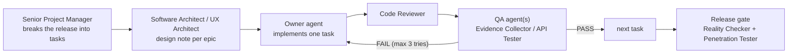

# Critical Notes: Project Plan

| | |
|---|---|
| Status | Release 1.0 shipped (v1.0.0, 2026-10-22); 1.1.0 to 1.2.0 shipped as post-1.0 follow-ups (not in this file); release 1.3 is broken down and in progress (Epic I1 done); 1.4 and later are assigned but not yet broken down |
| Date | 2026-10-13, updated 2026-10-23 |
| Specification | [PRD.md](PRD.md) (what and why). This file is the task list (who and how). |
| Engineering state | [STATUS.md](STATUS.md) · [ARCHITECTURE.md](ARCHITECTURE.md) · [PLAN.md](PLAN.md) |
| Agents | From [msitarzewski/agency-agents](https://github.com/msitarzewski/agency-agents) (see §2 and §9) |

## 1. Specification summary

**From the PRD (§1, §11):** "What separates it from a public 1.0 is not more features, but the basics a self-hosted product needs to be trusted with years of campaign notes: account recovery, backups, undo for deletions, a license, and a release process."

| Release | Theme | PRD items | In this file |
|---|---|---|---|
| **1.0** | Trustworthy to self-host | M1 License, M2 Accounts, M3 Backup, M4 Trash, M5 Release process, M6 Phone-width | 43 tasks, 10 waves (§5) |
| **1.1.0 to 1.2.0** | Post-1.0 follow-ups (shipped 2026-10-22) | Sign out other sessions, player-visible page count, accessibility backlog, keyboard block menu, page titles | Not planned here; see [CHANGELOG.md](../CHANGELOG.md) |
| **1.3** | Prep and play loop | N1 Page history, N3 Reveal to players, I1 Keep hidden links, I3 Tracker additions, I2 Query views | 24 tasks, 5 waves (§6) |
| **1.4** | Stay in sync | N2, N4, I4, I5, I10 | Assigned, broken down when scheduled (§7) |
| **Later** | Grow | N5–N17, I6–I18 | Assigned, broken down when scheduled (§7) |

**Technical stack (exact):** pnpm 11 monorepo, TypeScript 6.0.3, Node 24. Server: Hono, Drizzle ORM on better-sqlite3 (Postgres mirror schema), zod 4, `@modelcontextprotocol/server` 2.3.1. Web: Angular 22 (standalone, signals, zoneless, `httpResource`), Tailwind v4, TipTap v3. Tests: Vitest (unit/API), Playwright (`e2e/`, system Chrome, real 5etools data). Delivery: esbuild server bundle, Docker (non-root), docker-compose.

## 2. The team

Agents are referred to by their name in the repository; the file is in brackets. A task names one **owner** (does the work) and one or more **QA** agents (verify it). Decisions marked **Owner (human)** belong to the project owner, not to an agent.

### Coordination
| Agent | Role in this project |
|---|---|
| **Agents Orchestrator** (`specialized/agents-orchestrator`) | Runs the pipeline (§3): hands each task to its owner, then to QA, retries up to 3 times, escalates. Keeps the checkboxes in this file current. |
| **Senior Project Manager** (`project-management/project-manager-senior`) | Owns this file: breaks the next release into tasks, keeps scope to the PRD, re-plans when tasks fail. |
| **Product Manager** (`product/product-manager`) | Owns the PRD; accepts or rejects scope changes; prepares the owner's decisions (§8). |
| **Sprint Prioritizer** (`product/product-sprint-prioritizer`) | Re-ranks the backlog between releases using feedback and the PRD's value/effort method. |

### Design and research
| Agent | Role |
|---|---|
| **UX Architect** (`design/design-ux-architect`) | The "ArchitectUX" step for each epic with UI: flows, layouts, Tailwind patterns developers follow. |
| **UI Designer** (`design/design-ui-designer`) | Visual consistency of new screens (Account, Admin, Trash, History) in light and dark themes. |
| **UX Researcher** (`design/design-ux-researcher`) | Runs the "first evening" tests (PRD §4) and validates demand before big bets (N13). |
| **Game Designer** (`game-development/game-designer`) | D&D rules expert for combat and generators (I3, N4): exact 2014/2024 rules, what players may see. |
| **Narrative Designer** (`game-development/narrative-designer`) | Session recaps and story structure (N12), the "table moment" of reveals (N3). |

### Engineering
| Agent | Role |
|---|---|
| **Software Architect** (`engineering/engineering-software-architect`) | Design notes before code for cross-cutting work (page history, events, data model changes). |
| **Backend Architect** (`engineering/engineering-backend-architect`) | Server work: Hono routes, services, Drizzle schema, migrations, reducers in `@cn/shared`. |
| **Frontend Developer** (`engineering/engineering-frontend-developer`) | Angular UI: pages, components, guards, editor views. |
| **Identity & Access Engineer** (`engineering/engineering-identity-access-engineer`) | Accounts, password reset, admin, sessions, later OAuth for MCP (M2, N5). |
| **Database Reliability Engineer** (`engineering/engineering-database-reliability-engineer`) | Backups, restore, retention, migrations safety, later Postgres at run time (M3, N14). |
| **DevOps Automator** (`engineering/engineering-devops-automator`) | CI, release workflow, Docker image publishing (M5). |
| **Git Workflow Master** (`engineering/engineering-git-workflow-master`) | Branching, conventional commits, tags, merging parallel work (M5). |
| **Realtime Collaboration Engineer** (`engineering/engineering-realtime-collaboration-engineer`) | Server-sent events, live reveals, shared dice, later co-editing (N3, N9, N10). |
| **Minimal Change Engineer** (`engineering/engineering-minimal-change-engineer`) | Narrow bug fixes, starting with the hidden-links data loss (I1). |
| **MCP Builder** (`specialized/specialized-mcp-builder`) | The `/mcp` server: new tools when features land (history, trash), MCP improvements (I16, N12). |
| **Knowledge Graph Engineer** (`engineering/engineering-knowledge-graph-engineer`) | Relationship graph model (N8). |
| **Data Visualization Engineer** (`engineering/engineering-data-visualization-engineer`) | Graph and timeline rendering (N7, N8). |
| **Internationalization Engineer** (`engineering/engineering-i18n-engineer`) | Translations (N16). |

### Quality, security, docs and legal
| Agent | Role |
|---|---|
| **Code Reviewer** (`engineering/engineering-code-reviewer`) | Reviews every task's diff before QA. |
| **Evidence Collector** (`testing/testing-evidence-collector`) | Per-task QA in the browser with screenshots; PASS/FAIL with evidence. |
| **API Tester** (`testing/testing-api-tester`) | Per-task QA for endpoints: status codes, permissions, validation, error shapes. |
| **Test Automation Engineer** (`testing/testing-test-automation-engineer`) | Writes and maintains Playwright specs (`e2e/`); keeps them free of flakes. |
| **Accessibility Auditor** (`testing/testing-accessibility-auditor`) | WCAG checks on every new screen; the full audit later (I11). |
| **Performance Benchmarker** (`testing/testing-performance-benchmarker`) | "Fast at the table" budgets: search, queries, tracker (I2). |
| **Reality Checker** (`testing/testing-reality-checker`) | Release gate: certifies a release against the PRD's "Done when" criteria; defaults to NEEDS WORK. |
| **Security Architect** (`security/security-architect`) | Threat models for accounts, backups, events and OAuth before they are built. |
| **Application Security Engineer** (`security/security-appsec-engineer`) | Security review of every change touching auth, visibility or data export; keeps the sentinel tests complete. |
| **Penetration Tester** (`security/security-penetration-tester`) | Authorized test of a running 1.0 candidate (local instance only). |
| **Technical Writer** (`engineering/engineering-technical-writer`) | README, CHANGELOG, upgrade notes, admin and backup guides, keeping STATUS/ARCHITECTURE current. |
| **Developer Advocate** (`specialized/specialized-developer-advocate`) | CONTRIBUTING, issue templates, the public launch of 1.0. |
| **Legal Compliance Checker** (`support/support-legal-compliance-checker`) | License options and the content position (M1, N11). Advice to the owner, not legal counsel. |

**Not used, and why:** Senior Developer (Laravel/FluxUI specialist; this is Angular/Hono), Mobile App Builder (native apps are a PRD non-goal; phone support is responsive web), Search Relevance Engineer (built for Elasticsearch/OpenSearch; search here is SQLite FTS5, owned by the Backend Architect), Project Shepherd (overlaps the Orchestrator). The project's own `project-assistant` agent (`.claude/agents/`) stays available for ad-hoc work.

## 3. How work flows



1. **One task at a time per agent.** The Orchestrator gives the owner exactly one task, with its acceptance criteria and the project rules (§4).
2. **Review, then QA.** Code Reviewer first; then the task's QA agents. QA answers PASS or FAIL with evidence (test output, screenshots, request/response pairs).
3. **Retries.** A FAIL goes back to the owner with the QA feedback. After 3 failures the task is marked blocked and escalated to the Senior Project Manager (re-plan) or the owner (decision).
4. **Parallel work.** Tasks in the same wave (§5.7, §6.6) may run in parallel, each in its own git worktree. Tasks that change `apps/server/src/db/schema*.ts`, `app.routes.ts` or `app.ts` are merged one at a time by the Git Workflow Master.
5. **Checkboxes.** When a task passes QA, the Orchestrator ticks it (`### [x]`) and adds one line: `**Done:** <date>, QA <agent>: PASS`.
6. **Releases.** A release ships only after every task is ticked, the gate tasks pass, and the owner approves.

**Starting the pipeline.** "Activate Agents Orchestrator. Spec: `docs/PRD.md`. Task list: `docs/PROJECT.md`. Run Release 1.0, wave by wave."

## 4. Rules every agent follows

These come from the codebase and are not negotiable; QA fails a task that breaks one.

- [ ] **Gate:** `pnpm -s typecheck && pnpm -s lint && pnpm -s test` passes. Tasks with UI also pass `pnpm e2e` (needs the local 5etools clone).
- [ ] **Players never receive DM content.** Any endpoint returning campaign content projects it for players, and gets a sentinel string in `apps/server/test/visibility.test.ts`. MCP read tools are crawled too.
- [ ] **GM-only UI:** new GM-only routes use `canActivate: [gmGuard]`; the server checks regardless.
- [ ] **Schema changes** go into both `apps/server/src/db/schema.ts` and `schema.pg.ts`, then `pnpm --filter @cn/server db:generate`; the parity test must pass.
- [ ] **No edition string comparisons** (`'2014'`, `'2024'`, `'classic'`, `'one'`) outside `packages/fivetools/src/ruleset` and `edition` (ESLint enforces it).
- [ ] **No raw HTML:** no `innerHTML`, no `bypassSecurityTrust*` (lint guard).
- [ ] **Angular:** standalone, signals, OnPush, zoneless; an `effect` that calls async code wraps it in `untracked`.
- [ ] **Data:** never commit or upload `5etools-data/`, `var/`, test traces or screenshots containing rules text.
- [ ] **Git:** conventional commits; **never add Co-Authored-By lines**; no commit or push without the owner's go-ahead for that release.
- [ ] **Docs:** behaviour changes update `docs/STATUS.md`; departures from the PRD are logged in `docs/PLAN.md` (deviations) and raised with the Product Manager.
- [ ] **Scope:** build what the task says. Ideas go to the Product Manager, not into the diff.

## 5. Release 1.0: Trustworthy to self-host

### 5.1 Epic M1: License

### [x] Task M1.1: License options brief
**Owner**: Legal Compliance Checker · **QA**: Product Manager
**Done:** 2026-10-16, QA Product Manager: PASS (1 retry). Brief: `docs/legal/license-options.md`; recommendation Apache-2.0 (owner decides in M1.2).
**Description**: Compare MIT, Apache-2.0 and AGPL-3.0 for a self-hosted app (hosted forks, contributions, compatibility with dependencies). Review the content notice in README "Licensing" and DATA_NOTES §9 (5etools code MIT, WotC content and art, SRD 5.1/5.2 CC-BY-4.0, bring your own data).
**Acceptance Criteria**:
- `docs/legal/license-options.md` with a recommendation, trade-offs, and a dependency license check (`pnpm licenses list`)
- [THIRD_PARTY_NOTICES.md](../THIRD_PARTY_NOTICES.md) reviewed; a generated file with the full license text of every package in the server bundle (and any Apache-2.0 NOTICE files) is added to the build and the image
- Every claim in the README's licensing section marked correct or corrected
- States clearly that it is not legal advice
**Reference**: PRD §8 M1, §12

### [x] Task M1.2: Decide the license
**Owner**: **Owner (human)**, prepared by Product Manager · **QA**: none
**Done:** 2026-10-16, owner decision: Apache-2.0, DCO sign-off (no CLA), copyright holder "Merilairon" (see §8 D1).
**Description**: Choose the license from the brief. Record it in §8 (decision log).
**Depends on**: M1.1

### [x] Task M1.3: Publish the license
**Owner**: Technical Writer · **QA**: Code Reviewer
**Done:** 2026-10-16, QA Code Reviewer: PASS (full gate green).
**Description**: Add `LICENSE`; set `"license"` in every `package.json` (root, `apps/*`, `packages/*`); update the README licensing section.
**Acceptance Criteria**:
- `LICENSE` matches the decision; all `package.json` files agree
- README states the license and keeps the content notice
**Files**: `LICENSE`, `package.json` (×7), `README.md`
**Depends on**: M1.2

### [x] Task M1.4: Contributor files
**Owner**: Developer Advocate · **QA**: Technical Writer
**Done:** 2026-10-16, QA Technical Writer: PASS. Open: SECURITY.md contact placeholder until D2 (repository location).
**Description**: `CONTRIBUTING.md` (setup, data clone, gate, the rules in §4), `SECURITY.md` (private reporting), `.github/ISSUE_TEMPLATE/` (bug, feature), `.github/pull_request_template.md` (gate checklist, sentinel rule, no co-author lines).
**Acceptance Criteria**:
- A new contributor can set up and run the gate from CONTRIBUTING alone
- The bug template asks for version, install method and steps; never for rules content
**Depends on**: M1.3

### 5.2 Epic M2: Account recovery and user administration

### [x] Task M2.1: Accounts design and threat model
**Owner**: Identity & Access Engineer · **QA**: Security Architect
**Done:** 2026-10-16, QA Security Architect: PASS (2 retries). Design: `docs/design/accounts.md`. Awaiting owner: D5 and Q9 (see §8).
**Description**: Design without email: admin-issued one-time reset links (hashed like invite tokens, 24 h expiry, single use), disabling a user (ends sessions and API tokens), deleting a user (what happens to campaigns they own: transfer to a chosen member or archive), the last-admin rule, a command-line reset for a locked-out admin.
**Acceptance Criteria**:
- `docs/design/accounts.md` with flows, data model changes, endpoints and threats (enumeration, token theft, privilege escalation) with mitigations
- Reviewed against `apps/server/src/auth/session.ts` and `routes/auth.ts` (the `/password` route already exists)
**Reference**: PRD §8 M2

### [x] Task M2.2: Schema for accounts
**Owner**: Backend Architect · **QA**: Database Reliability Engineer
**Done:** 2026-10-16, QA Database Reliability Engineer: PASS. Migrations `drizzle/0006_accounts`, `drizzle-pg/0002_accounts`.
**Description**: Add `users.disabled_at` and a `password_resets` table (id, user_id, token_hash, created_by, expires_at, used_at) to both schemas; generate migrations.
**Acceptance Criteria**:
- Migrations for SQLite and Postgres generated; pg parity test passes
- Existing data migrates without loss (test on a copy of a populated `var/`)
**Files**: `apps/server/src/db/schema.ts`, `schema.pg.ts`, `drizzle/`, `drizzle-pg/`
**Depends on**: M2.1

### [x] Task M2.3: Self-service account endpoints
**Owner**: Identity & Access Engineer · **QA**: API Tester
**Done:** 2026-10-16, Code Reviewer PASS, QA API Tester: PASS (live instance). Reset-budget wiring deferred to M2.5. Note: apps/server has no `test` script; use root `pnpm test`.
**Description**: `PATCH /api/auth/me` (display name); make the existing password change end the user's other sessions; disabled users can't sign in and their sessions and API tokens stop working (`ApiTokenService.verify`).
**Acceptance Criteria**:
- Changing the password signs out other browsers but not the current one
- A disabled user gets 401 everywhere, including `/mcp`
**Files**: `apps/server/src/routes/auth.ts`, `auth/session.ts`, `services/api-tokens.ts`
**Depends on**: M2.2

### [x] Task M2.4: Admin user endpoints
**Owner**: Backend Architect · **QA**: API Tester, Application Security Engineer
**Done:** 2026-10-16, Code Reviewer PASS, QA API Tester: PASS, Application Security Engineer: PASS. Follow-ups (low, non-blocking): reject transfer to a disabled member; make the step-up rate limit count before verify (atomic); consider a password for enabling an admin target; archived campaigns have no `dm` (only `codm`), so owner-only actions are dead until a transfer, noted for M2.8.
**Description**: `requireAdmin` routes under `/api/admin/users`: list; create a reset link (shown once); disable/enable; grant/revoke admin; delete with the ownership rule from M2.1. Never remove the last admin; an admin can't disable themselves.
**Acceptance Criteria**:
- Non-admins get 403 on every route; the last-admin rule holds under every path
- Reset tokens are stored hashed; the link is in the response once
- Not reachable from the MCP API allowlist (`apps/server/src/mcp/api.ts`)
**Files**: new `apps/server/src/routes/admin.ts`, `services/users.ts`, `app.ts`
**Depends on**: M2.2

### [x] Task M2.5: Password reset by link
**Owner**: Identity & Access Engineer · **QA**: API Tester
**Done:** 2026-10-16, Code Reviewer PASS (1 round of small fixes), QA API Tester: PASS (live instance).
**Description**: `GET /api/auth/reset/:token` (valid or not, for whom) and `POST /api/auth/reset/:token` (new password; single use; rate limited like login).
**Acceptance Criteria**:
- Expired, used and unknown tokens answer alike (no enumeration)
- After a reset, all of that user's sessions end
**Depends on**: M2.4

### [x] Task M2.6: Command-line admin reset
**Owner**: Backend Architect · **QA**: DevOps Automator
**Done:** 2026-10-16, Code Reviewer PASS, QA DevOps Automator: PASS (native against a running server under write load, and in a real container as the non-root user). `dist/admin.mjs` has a subcommand registry for M3.3.
**Description**: `node dist/admin.mjs reset-link <username>` prints a reset link; works in Docker (`docker compose exec app node admin.mjs …`). Add the entry to `apps/server/scripts/build.mjs`.
**Acceptance Criteria**:
- Works against a running instance's database (SQLite WAL) and in the container
- Documented in the README
**Depends on**: M2.5

### [x] Task M2.7: Account page: profile and password
**Owner**: Frontend Developer · **QA**: Evidence Collector, Accessibility Auditor
**Done:** 2026-10-16, Code Reviewer PASS, QA Evidence Collector: PASS (browser), Accessibility Auditor: PASS (axe 0 violations light and dark; 1 retry). Deferred app-wide findings: shared input border contrast (1.4.11) and skip link to G1.2; header reflow at 320px to M6.3.
**Description**: Add display name and password sections to `apps/web/src/app/account/account-page.ts` (current password, new password twice).
**Acceptance Criteria**:
- Errors shown inline; success confirmed; keyboard and screen-reader usable
- Unit spec next to the component
**Depends on**: M2.3

### [x] Task M2.8: Admin: users page
**Owner**: Frontend Developer · **QA**: Evidence Collector
**Done:** 2026-10-16, Code Reviewer PASS (1 round of fixes), QA Evidence Collector: PASS (browser, items 1-6). Design: `docs/design/admin-users-ui.md`. Also shipped (server prep): transfer to a disabled member rejected, enabling an admin needs the password, step-up limiter counts before verify and gives back only its own attempt. Owner decisions: Archive kept with a warning; enable-admin needs password. Follow-ups: pin the dialog footer at 390px; admin header overflows 35px at 390px (M6.3, the Users link tips it over); `homebrew.test.ts` has a load-sensitive 5s timeout.
**Description**: `/admin/users` (admin guard): list with role badges; "Reset link" (shown once with copy); disable/enable; admin toggle; delete with the ownership choice. Header link for admins only.
**Acceptance Criteria**:
- Non-admins can't reach the route (guard) and don't see the link
- Destructive actions confirm first
**Files**: new `apps/web/src/app/admin/`, `app.routes.ts`, `app.html`
**Depends on**: M2.4 · **Design**: UX Architect (one screen sketch before the task)

### [x] Task M2.9: Reset page
**Owner**: Frontend Developer · **QA**: Evidence Collector
**Done:** 2026-10-16, Code Reviewer PASS, QA Evidence Collector: PASS (browser, axe 0 violations on the page). Link is `/reset#<token>` (logged in PLAN.md). Follow-up for the app-wide a11y backlog (G1.2): `label-content-name-mismatch` on the header Search button.
**Description**: `/reset/:token` outside the auth guard: shows whose account, sets the new password, signs in.
**Depends on**: M2.5

### [x] Task M2.10: Account tests
**Owner**: Test Automation Engineer · **QA**: Reality Checker
**Done:** 2026-10-16, QA Reality Checker: PASS. `pnpm e2e` 60/60; `e2e/admin.spec.ts` 6/6 repeatedly and against the Docker image (`E2E_BASE`). Epic M2 certified against PRD §8 M2 (all items MET). Caveats: no e2e for the last-admin refusal, grant admin or the CLI reset (covered by server tests); sign-up is rate limited to 8 per minute per address, so specs must stay under it.
**Description**: `e2e/admin.spec.ts`: admin creates a reset link → user resets → signs in; disabled user can't sign in; MCP token of a disabled user fails.
**Acceptance Criteria**: passes in `pnpm e2e` and against the Docker image (`E2E_BASE`)
**Depends on**: M2.7, M2.8, M2.9

### 5.3 Epic M3: Instance backup and restore

### [x] Task M3.1: Backup design
**Owner**: Database Reliability Engineer · **QA**: Security Architect
**Done:** 2026-10-17, QA Security Architect: PASS (3 retries). Design: `docs/design/backup.md` (approved; owner approved its D1-D10 as recommended). Hard-earned notes for M3.2/M3.3: fflate `Unzip` pre-registers method 0, so restore must gate on `file.compression === 8` before `start()`; the highest-risk item is M3.3's blocker test (schema allowlist stable across all historical migration levels), schedule it first; M4's purge must respect `BackupService.isRunning()`; record the checksums.json (4th entry) and manifest `trigger` field in `docs/PLAN.md`.
**Description**: Format: one zip with `app.sqlite` (SQLite online backup, consistent while the server writes), `uploads/`, and `manifest.json` (app version, migration level, created at). `index.sqlite` is excluded (rebuilt on start). Restore rules (only into a stopped instance; refuse a backup from a newer migration level). Retention. Backups contain password hashes and token hashes: who may download them.
**Acceptance Criteria**: `docs/design/backup.md` approved; threat notes on backup files
**Reference**: PRD §8 M3

### [x] Task M3.2: Backup service
**Owner**: Database Reliability Engineer · **QA**: API Tester
**Done:** 2026-10-17, Code Reviewer PASS (1 round of fixes), Security Architect APPROVED (2 rounds), QA API Tester: PASS (real server under a concurrent writer, 35 corruption cases, streaming, prune oracle). Deviation approved and logged in PLAN.md and `docs/design/backup.md` §5/§9.1: the restore reader is a central-directory reader on `node:zlib`, not fflate `Unzip` (which fails on incompressible data containing `PK\x07\x08`); the writer emits its own central directory. For M3.3/M3.4/M3.6: busy server can starve a CLI backup (say so in the message); a SIGKILLed backup looks "already running" for 2 min with leftovers for 1 h (guide); a database compressing better than 50:1 fails its own verify with a vague reason (N2, consider a clearer message); cold-process RSS growth is 70-76 MiB, not under 64 MiB as the design said (N1); API-created backups are capped at 3x keep. Follow-ups: tests for the `schemaOf` limit and default verify budget; fresh-DB compression ratio proximity (48.8:1 vs 50:1).
**Description**: `BackupService.create()` writes `DATA_DIR/backups/backup-<timestamp>.zip` (better-sqlite3 `backup()`, `fflate`); `list()`; `prune(keep)`.
**Acceptance Criteria**:
- A backup taken while a test writes pages restores to identical data (automated test)
- Large uploads folders stream without loading everything into memory
**Files**: new `apps/server/src/services/backups.ts`, tests
**Depends on**: M3.1

### [x] Task M3.3: Backup and restore commands
**Owner**: Database Reliability Engineer · **QA**: DevOps Automator
**Done:** 2026-10-17, Code Reviewer PASS, Security Architect APPROVED (1 round: probe failed open on non-BUSY errors, root-run chown followed symlinks, marker validation), QA DevOps Automator: PASS (native against a running server incl. SIGKILL mid-restore and resume; real Docker container as `node` and as root; restart-policy interplay; gate green). Restore drill: `pnpm --filter @cn/server build && pnpm --filter @cn/server drill` (M5.2 should call it). Schema-allowlist blocker test is permanent (`schema-allowlist.test.ts`; a new migration using RENAME/DROP COLUMN/trigger/view/ANALYZE etc. must be reviewed and added to `REVIEWED`). For M3.6 guide (from QA): say the Docker backup lives in the `app-data` volume and how to copy it out (`docker compose cp app:/data/app/backups/<zip> .`); run `docker compose stop app` before an interrupted-restore re-run and `start` after (restart policy crash-loops with a clear message meanwhile); non-Docker commands need a build and the same `DATA_DIR`/`.env`; delete `pre-restore-*` after verifying; a SIGKILLed backup looks "already running" for 2 min; a busy server can starve a CLI backup; Info-ZIP unzip zip-bomb note for entries beyond 4 GiB. Cosmetic: a flipped byte reports "entry app.sqlite exceeds its limit" before the generic invalid-backup line.
**Description**: `node dist/admin.mjs backup` and `restore <file>` (refuses while the server runs; checks the manifest).
**Acceptance Criteria**: a restore drill (backup → wipe → restore → start) passes in CI
**Depends on**: M3.2, M2.6 (shares `admin.mjs`)

### [x] Task M3.4: Admin backup endpoints and page
**Owner**: Backend Architect (endpoints), Frontend Developer (page) · **QA**: API Tester, Evidence Collector
**Done:** 2026-10-17. Endpoints: Code Reviewer PASS (1 round: a test race), Application Security Engineer APPROVED (hardening applied: download idle timeout, FIFO/hardlink refusal, HEAD 405, ip in audit lines), QA API Tester: PASS (live instance, 34 name variants, ticket matrix, streaming, audit). Page: Code Reviewer PASS, QA Evidence Collector: PASS after 1 retry (browser, download sha256 matches, no ticket anywhere, axe 0 violations at 390px). Admin nav Users | Backups on both admin pages; header link unchanged. Follow-ups: refused 409 creates count against the 3-per-10-min limiter budget; lock a session after 10 wrong download passwords (not built); `backup.downloaded` is audited when the file is opened, not at completion; a bare "Download interrupted" stderr line on aborted streams; hardlinked file shows in the list but cannot be downloaded (cosmetic); guide must tell hosts to redact the `ticket` query parameter in proxy logs.
**Description**: `POST/GET /api/admin/backups`, `GET /api/admin/backups/:name` (download); `/admin/backups` page with "Back up now", list, download.
**Acceptance Criteria**: admin only; file names validated (no path traversal); not in the MCP allowlist
**Depends on**: M3.2, M2.8

### [x] Task M3.5 (stretch): Scheduled backups
**Owner**: Database Reliability Engineer · **QA**: API Tester
**Done:** 2026-10-18, Code Reviewer PASS, QA API Tester: PASS (real processes: off by default, invalid values refuse to start without blocking the CLI, catch-up at 60-90 s exactly once, overlap/restore-marker skips, failure backoff 15 min then 60 min, retention per design §11, SIGTERM/SIGINT with a running backup). Off by default; `BACKUP_EVERY_HOURS` 1-720; the admin page shows one schedule line. Follow-ups (low): with the scheduler on, SIGTERM does not wait for a MANUAL web backup (only scheduled runs are awaited; nothing partial is published); signal handlers are only installed when the scheduler is on, so with it off Node as Docker PID 1 ignores SIGTERM and `docker stop` waits 10 s (pre-existing; consider always installing them); `backup.failed` audit reason can contain an absolute path (server log only); a killed backup's `.lock` blocks new backups for about 2 min; leftovers are removed after 1 h. Guide (M3.6) should recommend enabling the scheduler (it is what protects against old backups being rotated out).
**Description**: `BACKUP_EVERY_HOURS` and `BACKUP_KEEP` settings; runs in the server process.
**Depends on**: M3.2

### [x] Task M3.6: Backup guide
**Owner**: Technical Writer · **QA**: Database Reliability Engineer
**Done:** 2026-10-18, QA Database Reliability Engineer: PASS (2 retries). README `## Backups` (quick start, what is in a backup, making/copying/restoring, new machine, exit codes, troubleshooting, 3 a.m. block, compromise checklist, rehearsal). Every recipe was run literally by QA, in Docker and bare, and exit codes 66/67/74/77/78, ANALYZE, older-version migration and CHECK THESE NOW were reproduced. Code follow-ups recommended by QA (NOT built; decide before 1.0): pass `BACKUP_EVERY_HOURS`/`BACKUP_KEEP`/`BACKUP_DIR` through `docker-compose.yml` and consider default-on 24 h; always install SIGTERM/SIGINT handlers and add `init: true` (Node as PID 1 ignores SIGTERM, `docker stop` takes 10 s); fix the Backups page restore hint (shows `restore backups/<file>`; real program is `apps/server/dist/admin.mjs`, path relative to the cwd) and the `dist/admin.mjs` strings in restore-marker.ts/reportText; treat a live instance with zero users as "nothing to compare" (noisy CHECK THESE NOW); lock-out guard when carry-over leaves no enabled admin; check `BACKUP_DIR` writability at startup; report text should say `docker compose up -d` when no container exists; app version is 0.0.0 until M5.4.
**Description**: README section: what's in a backup, how to back up and restore with and without Docker, copying backups off the machine.
**Depends on**: M3.3, M3.4

### [x] Task M3.7: Backup follow-ups (Docker and CLI polish)
**Owner**: Backend Architect (compose, signals, startup check, CLI messages), Frontend Developer (Backups page hint), Technical Writer (README) · **QA**: DevOps Automator, Evidence Collector
**Done:** 2026-10-18. Code Reviewer: 2 FAILs (a shutdown test that only passed on a loaded machine because its seed exceeded the 16 MiB upload cap; no test for the production guard on the test-only hold seam), both fixed; QA DevOps Automator: 1 FAIL (an unfinished backup's `.partial`/`.tmp`/`.lock` stayed after a shutdown timeout and blocked new backups for ~2.5 min), fixed, re-tested PASS in real containers; QA Evidence Collector: PASS (page hints, cap and error texts, fallback, axe 0 violations at 390px, download regression). That was the third failure: the Project Manager re-planned a final narrow fix instead of blocking. Compose now passes `BACKUP_EVERY_HOURS` (default 24, B2), `BACKUP_KEEP`, `BACKUP_DIR`, has `init: true` and `stop_grace_period: 15s`; the server always handles SIGTERM/SIGINT (waits up to 8 s for a running backup, removes its own unfinished backup's files, second signal force-quits); non-writable `BACKUP_DIR` refuses to start / CLI exit 73; the Backups page and CLI messages show working commands built from `directory` and `adminPrograms`. Two test-only env seams exist (`CN_TEST_BACKUP_HOLD_FILE`, ignored in production and covered by a test; `SHUTDOWN_BACKUP_WAIT_MS`, 1-8000). Still open (noted, not built): lock-out guard when carry-over leaves no enabled admin; noisy CHECK THESE NOW on an empty-but-started instance; clearer message for an unreadable live `app.sqlite`; app version `0.0.0` until M5.4; the cap detection on the page keys on the server's 409 text (an error code would be sturdier); the header's main nav overflows 35 px at 390px (M6.3). Incident during QA: an Evidence Collector run restored into the real `var/` by mistake (see the session notes); `var/` held only an empty `uploads/` before, nothing was lost.
**Description**: Small code fixes that QA of M3.6 found behind the backup guide's workarounds. Nothing here changes the backup format or the restore procedure.
1. **Compose passes the backup settings.** `docker-compose.yml` passes `BACKUP_EVERY_HOURS`, `BACKUP_KEEP` and `BACKUP_DIR` into the container, so a value in `.env` takes effect (an empty value behaves as unset). The default for `BACKUP_EVERY_HOURS` in the shipped compose file follows decision B2 (§8). Bare installs stay off.
2. **Clean shutdown, always.** The server handles SIGTERM and SIGINT whether or not scheduled backups are on: it stops accepting requests, waits up to 8 s for a running backup (scheduled **or manual**), closes the databases and exits 0. Add `init: true` to the compose service. `docker stop` on an idle container takes under 3 s and Ctrl+C works in `docker run`. A second signal still force-kills.
3. **`BACKUP_DIR` must be writable.** At startup (and for the CLI) the server checks that the app user can create and write in `BACKUP_DIR` and refuses to start with a clear message naming the fix (`chown 1000:1000`); today the failure only shows in the log about 90 s later. `EACCES` on backup also maps to a readable error.
4. **Correct restore hints.** The Backups page and the CLI messages (`restore-marker.ts`, `reportText`) show a command that works: `--check` first, the real program path (`apps/server/dist/admin.mjs` for a bare install), and the backups directory the server actually uses (an additive, admin-only field in the list DTO), in both Docker and bare form. The report says `docker compose up -d` when no container exists yet.
5. **README follows.** Remove the stopgaps from `## Backups`: the compose override recipe, the "docker stop takes 10 seconds" notes, the Backups-page-hint note and the `--init` workaround for `docker run`; keep every other statement true.
**Acceptance Criteria**:
- `docker compose config` shows the three variables; a value set in `.env` is visible with `printenv` inside the container (verified in a real container)
- `docker compose stop app` on an idle container takes under 3 s with the scheduler on **and** off; SIGTERM during a manual web backup waits for it (up to 8 s) and leaves no partial file; Ctrl+C works in `docker run -it`
- A non-writable `BACKUP_DIR` makes the server and `admin.mjs backup` fail at once with the documented message; nothing is created
- The page hint and the CLI messages work when pasted from the repo root and in Docker, for the default and a custom `BACKUP_DIR`
- Tests for each item (spawned-process tests for the signals and the startup refusal); the README matches the behaviour; gate green
**Files**: `docker-compose.yml`, `apps/server/src/main.ts`, `config.ts`, `cli/restore-marker.ts`, `cli/restore.ts`, `routes/backups.ts`, `packages/shared/src/backups.ts`, `apps/web/src/app/admin/backups-page.ts`, `README.md`, `docs/STATUS.md`
**Not in this task (kept as noted follow-ups):** the lock-out guard when a restore's carry-over would leave no enabled admin; the noisy "CHECK THESE NOW" block when restoring onto an instance that was started once and left empty (treat zero live users as nothing to compare); a clearer message for an unreadable live `app.sqlite`; the app version stays `0.0.0` until M5.4.
**Depends on**: M3.6 · **Decision**: B2 (§8)

### 5.4 Epic M4: Trash

### [x] Task M4.1: Trash endpoints
**Owner**: Backend Architect · **QA**: API Tester, Application Security Engineer
**Done:** 2026-10-18, Code Reviewer PASS, QA API Tester: PASS (real isolated instance: access matrix, nested trees, restore, purge, aged 30-day purge), Application Security Engineer: APPROVED (4 Low). Owner decision: co-DMs may view, restore and purge the trash (same `requireDm` rule as the other DM-only routes). Follow-ups queued as one fix round before M4.2: purge-test search assertions, purge-then-restore test for an earlier-deleted subpage, `start()` guard, MCP-allowlist negative tests for trash and purge (purge stays off the allowlist by design), purger clock-jump sanity check. Noted, not built: purge of a huge trash is one synchronous pass; `encounters.locationPageId` can point at a purged page; the purge route does not touch the campaign; dangling `pageLink` nodes in bodies after purge (check the editor renders them gracefully in M4.3). Design for M4.3: `docs/design/trash-ui.md`.
**Description**: `GET /api/campaigns/:cid/trash` (deleted page trees: root, subpage count, deleted at), `DELETE /pages/:pid/purge` (permanent), purge of items older than 30 days at start and daily. `POST /pages/:pid/restore` already exists (`PageService.restore`).
**Acceptance Criteria**:
- GM only; players get 403; the sentinel crawl includes the trash route
- Purge removes derived rows (links, references, search) and upload references stay valid
**Files**: `apps/server/src/routes/campaigns.ts`, `services/pages.ts`, `test/visibility.test.ts`
**Reference**: PRD §8 M4

### [x] Task M4.2: Templates restore
**Owner**: Backend Architect · **QA**: API Tester
**Done:** 2026-10-18, Code Reviewer PASS (+ one tests/docs round), QA API Tester: PASS (real isolated instance: personal and campaign permission matrix, built-ins, extends 409 then parent-first, usage and propagation after restore, campaign default not restored, audit lines, no content to players). Routes: `GET /api/templates/trash[?campaignId=]`, `POST /api/templates/:id/restore`. Side effect to know: `dmCampaignIds` now counts co-DMs, so co-DMs can also list, edit, delete and see usage of campaign templates (consistent with pages; logged in PLAN.md for the Product Manager). Follow-ups: templates are not purged after 30 days (decide whether to); restore checks only the direct `extends` parent; players never see campaign templates at all (pre-existing, worth one line in the PRD/STATUS).
**Description**: Templates are soft-deleted already (`deletedAt`); add list-deleted and restore for the user's own and campaign templates.
**Depends on**: M4.1

### [x] Task M4.3: Trash view and undo
**Owner**: Frontend Developer · **QA**: Evidence Collector
**Done:** 2026-10-18. Code Reviewer: FAIL (2 blockers: stuck Undo state after a failed Undo; focus lost after a stale row), fixed, then PASS twice. QA Evidence Collector: PASS (browser, design §7 checklist: no confirm on delete, Undo restores subpages/backlinks/search, Trash restore and permanent delete, stale rows, aged items, states, 390px light and dark, dangling link). Accessibility Auditor: partial on the first pass (3 moderate focus defects: Dismiss/Esc and failed Undo dropped focus to BODY; the toast could cover focused elements on short screens), fixed, re-verified PASS (focus targets, cover fraction, `aria-busy`, 44px Dismiss, axe 0 violations in 8 runs at 390px). Owner decision (2026-10-18): page delete has no `confirm()`; Undo plus the 30-day trash replaces it. `TRASH_RETENTION_DAYS` now lives in `@cn/shared`. Follow-ups (not built): the post-Undo wait for the title input is not cancelled on destroy (rare focus steal within ~1 s); the read-only block renderer still shows a purged page link as a normal link; the dice toast and Undo toast may overlap at phone width for ~4 s (not reproduced); focus does not move on route change after an editor delete (by design, app-wide, G1.2); co-DM access of the Trash view was not browser-tested; app-wide issues sent to G1.2/M6.3 (sidebar `listitem`, header overflow at 390px, editor field names). Design: `docs/design/trash-ui.md`.
**Description**: Campaign "Trash" view (GM only) with Restore and Delete permanently; a toast "Deleted · Undo" after deleting a page.
**Acceptance Criteria**: restoring brings back subpages, backlinks and search results (checked in the browser)
**Files**: `apps/web/src/app/campaign/` (new `trash.ts`), `campaign-shell.ts`, `page-editor.ts`
**Depends on**: M4.1 · **Design**: UX Architect

### [x] Task M4.4: MCP tools for the trash
**Owner**: MCP Builder · **QA**: API Tester
**Done:** 2026-10-18, Code Reviewer PASS (+ explicit field mapping), QA API Tester: PASS (real /mcp with real tokens: 32 tools = 12 read / 20 write; GM, co-DM, player, outsider, bad ids; delete_page, list_trash, restore_page round trip; purge unreachable over MCP). `list_trash` returns `{id, title, type, icon, subpageCount, deletedAt}` only. `restore_page` and `delete_page` already existed. Follow-up (low, not built): the templates allowlist rule `^/api/templates(/ID)?$` also matches `GET /api/templates/trash`, so `get_template({templateId:"trash"})` would return the caller's own template-trash list (no definitions, only what the caller can edit; harmless, but tighten the rule or add a test if M4.2 routes ever grow).
**Description**: `list_trash` (read) for the assistant, so it can find what it deleted; allowlist the route.
**Depends on**: M4.1

### [x] Task M4.5: Trash tests
**Owner**: Test Automation Engineer · **QA**: Reality Checker
**Done:** 2026-10-18, QA Reality Checker: PASS. `e2e/trash.spec.ts` (4 tests: Undo, Restore from Trash, Delete permanently, player has no Trash). Reality Checker's own runs: gate green; `pnpm e2e` 64/64; the spec 5/5 on two extra runs; the spec 5/5 against a Docker image built from the tree (`E2E_BASE`); a mutation that loses subpages on restore fails 2 tests. **Epic M4 certified against PRD §8 M4 with caveats** (no hard blockers): the "restore from the UI with links, backlinks and search intact" criterion is MET; templates have an API only (see D6 in §8). Caveats: the e2e would not notice a missing reindex on restore and never asserts the backlink is absent while trashed (the server test covers both); the full e2e suite uses exactly the 8 sign-ups per minute allowed, so no new spec may register another person without sharing one (M5.3 CI should watch it); no browser test of the co-DM Trash view or at 390px.
**Description**: `e2e/trash.spec.ts`: delete a page with a subpage → restore from the trash → content, backlinks and search intact; undo toast works.
**Depends on**: M4.3

### [x] Task M4.7: Template purge (same behaviour as pages)
**Owner**: Backend Architect · **QA**: API Tester, Application Security Engineer
**Done:** 2026-10-18, Code Reviewer PASS (twice, with a hardening round in between), Application Security Engineer: APPROVED (3 Low), QA API Tester: PASS (real isolated instance: permission matrix, live and built-in refused, audit line with scope and campaign, versions/usage/defaults removed, pages keep content, child of a purged parent, aged scheduler purge removes only templates older than 30 days and leaves a built-in alone, pages purge still works in the same pass, MCP `get_template` refuses `trash` and `export`). Route: `DELETE /api/templates/:id/purge` -> `{ purged: [id] }`. The purger now isolates pages and templates, so one failing does not skip the other. Notes for M4.6 (not started, on hold by the owner): a child template whose parent was purged loads with an `issues` entry; an edit that sends a definition keeping the dangling `extendsRef` gets 400 "The template to extend was not found" (clear or change the parent in the same save); a name-only update still succeeds. Not built: a clock that jumps far forward is not detected (same limit as pages).
**Description**: Trashed templates get the same lifecycle as trashed pages (owner decision D6, 2026-10-18). (1) `DELETE /api/templates/:id/purge`: permanent delete of a trashed template the caller can edit (same permission rule as restore; 400 for a live template, 404 for unknown or not-editable, built-ins impossible), with an audit line `template.purged`. (2) The existing `TrashPurger` also removes templates deleted more than 30 days ago (same cutoff constant `TRASH_RETENTION_DAYS`, same deferral during backups and restores, same clock sanity check). (3) Purge removes the template's versions, usage rows and campaign-default rows; pages created from it keep their content and simply stop being linked; a child template that `extends` a purged template must not break (decide and document: it keeps working with an `issues` entry, or purge is refused while a live child extends it). (4) The list DTO (`TemplateTrashItemDto`) already carries `deletedAt`; nothing leaks to players. (5) MCP: unchanged (no purge tool; the template trash routes stay off the allowlist except where the existing generic rule already matches; tighten the `^/api/templates(/ID)?$` rule so `get_template({templateId:"trash"})` no longer reaches the trash list).
**Acceptance Criteria**:
- Tests for purge permissions (owner, co-DM, player, stranger, anonymous), live template refused, aged purge by the scheduler, deferral, instances and children after purge, and the allowlist tightening
- Sentinel crawl still green; no schema change expected (if one is needed, both schemas + `db:generate`); gate green
**Files**: `apps/server/src/services/templates.ts`, `routes/templates.ts`, `services/trash-purger.ts`, `mcp/api.ts`, tests, `docs/STATUS.md`, `docs/PLAN.md`
**Depends on**: M4.2

### [x] Task M4.6: Templates restore in the template manager
**Owner**: Frontend Developer · **QA**: Evidence Collector, Accessibility Auditor
**Done:** 2026-10-18. Code Reviewer: PASS after three rounds (stale-response guards across campaign changes, silent reloads, announced 409 message, chain wording, the issues sentence matched too broadly). QA Evidence Collector: PASS (real Chrome: scoping, Restore, Delete permanently, stale rows, the 409 parent flow, campaign switching, error and retry, co-DM, 390px light and dark). QA Accessibility Auditor: partial on the first pass (focus lost to BODY after "Restore the parent first" with a vanished parent and after "Try again"; "Delete permanently" label not containing the visible text), fixed over three rounds, final re-check PASS (axe 44 runs, focus targets, labels, separator, chain). This was the third fix round: the task was not blocked. The UI is a "Deleted templates" section at the bottom of the template library (`/templates` personal only, `/c/:id/templates` that campaign only), no new route. Cross-task change: the page Trash button labels are now `Restore: <name>` and `Delete permanently: <name>` (label in name, WCAG 2.5.3) and its age line has a screen-reader separator. Follow-ups (not built): a child restored after its parent was purged only gets a sentence in the restore status (the editor itself shows no warning); the 400 on saving a template that keeps a dangling parent is untouched; the "refresh()" error message in the library is not cleared by a later success (same as import); two cosmetic string nits in `template-trash.ts`; no e2e for the 409 chain or the co-DM path (unit specs only); no real screen reader tested.
**Description**: Add a small "Deleted templates" list to the existing template manager UI on top of the M4.2 and M4.7 API (`GET /api/templates/trash[?campaignId=]`, `POST /api/templates/:id/restore`, `DELETE /api/templates/:id/purge`). Each row shows the template name, its scope (personal or campaign), when it was deleted and "purged in N days" (same wording and accent rule as the page Trash), with Restore and Delete permanently (native confirm, as on the page Trash). Restore is instant with no confirm; the row disappears and the template shows up in the normal list. When the server answers 409 because the template's parent (`extends`) is still in the trash, show its message and a "Restore the parent first" action. Empty, loading and error states as on the page Trash. Visible only to those who can edit the templates (the API already scopes this).
**Acceptance Criteria**:
- A deleted personal template and a deleted campaign template (as DM and as co-DM) can be restored from the UI; linked instances follow later versions again
- The 409 parent case is readable and recoverable; a player sees nothing
- Reuses the Trash page patterns from `docs/design/trash-ui.md` (focus after restore, live region, 44px targets at 390px, light and dark); axe clean; unit spec next to the component; the gate and `pnpm e2e` stay green
- Delete permanently removes the row and the template for good; a stale row (already restored or purged) disappears without an error
**Files**: the template manager under `apps/web/src/app/` (find it first), `docs/STATUS.md`
**Depends on**: M4.2, M4.3, M4.7 · **Decision**: D6 (§8)

### 5.5 Epic M5: Release process

### [x] Task M5.1: Repository and branching
**Owner**: Git Workflow Master · **QA**: **Owner (human)**
**Done:** 2026-10-19, QA owner: approved. History kept (20 commits plus M5), audited clean (no rules content, secrets or co-author lines; every commit signed off); default branch renamed `master` to `main` and pushed by the owner. Branch model in CONTRIBUTING.md.
**Description**: The first commit (nothing is committed yet), the remote (decision in §8), `main` plus short-lived branches, conventional commits, tags `vX.Y.Z`. Check `.gitignore` keeps `5etools-data/`, `var/`, test output and `e2e/.auth/` out.
**Acceptance Criteria**: history starts clean; no rules content, no secrets, no co-author lines in any commit
**Depends on**: M1.3 (license in the first public commit)

### [x] Task M5.2: CI for the gate
**Owner**: DevOps Automator · **QA**: Code Reviewer
**Done:** 2026-10-19, QA Code Reviewer: PASS (1 round: SHA-pinned actions at current majors, Dependabot for actions, restore drill step, `workflow_dispatch`). Local gate+build+drill about 1.5 min; NOT yet run on GitHub (nothing pushed). Deliberate deviation: push trigger is `main` only, pull requests cover branches (PLAN.md). First push must be `main`.
**Description**: GitHub Actions: pnpm install (cached), typecheck, lint, unit/API tests (synthetic fixture), build. Runs on every push and pull request.
**Acceptance Criteria**: green on `main`; under 10 minutes
**Files**: `.github/workflows/ci.yml`
**Depends on**: M5.1

### [x] Task M5.3: Browser tests in CI without leaking data
**Owner**: DevOps Automator · **QA**: Application Security Engineer
**Done:** 2026-10-19, QA Application Security Engineer: PASS (1 retry). `.github/workflows/e2e.yml` for a self-hosted runner (`[self-hosted, linux, 5etools]`), same-repository PRs and manual runs only, no artifacts or caches; under `E2E_NO_ARTIFACTS=1` a custom reporter (`e2e/ci-reporter.ts`) prints only titles, status and file:line (a leak probe with rules text and console output left the log clean), the web server output is dropped, and cleanup removes reports, results and temp data. Inactive until the owner registers a runner (D4: workflow now, runner later). Trust warning in STATUS.md: a collaborator's PR runs its own code on the runner, so use a private repo, an ephemeral unprivileged runner, a read-only clone and required reviewers. Also fixed a real race in `homebrew.spec.ts` (Ctrl+K before the app was ready). Never run on GitHub. Follow-up (low): the same race pattern at `e2e/editor.spec.ts:88`.
**Description**: A job for `pnpm e2e` on a self-hosted runner that has a local 5etools clone. Traces and screenshots are not uploaded as artifacts (they contain rules text).
**Acceptance Criteria**: runs on pull requests from the main repository only; no data leaves the runner
**Depends on**: M5.2, decision D4 (§8)

### [x] Task M5.4: Version in the app
**Owner**: Backend Architect · **QA**: API Tester
**Done:** 2026-10-19, Code Reviewer PASS, QA API Tester: PASS (built bundle on an isolated instance: public `/api/health` `{ok,version}`, CLI and API backup manifests, a `0.0.0` backup still passes `restore --check`). Version `1.0.0-dev` in the root `package.json` (workspace packages carry the same value, unread); M5.5 replaces it per tag. Follow-up (low): document that `/api/health` is public (a proxy can restrict it).
**Description**: One version source (root `package.json`), returned by `/api/health` and shown in the app footer or Account page; written into backups' manifests.
**Depends on**: M5.1

### [x] Task M5.5: Release workflow
**Owner**: DevOps Automator · **QA**: Reality Checker
**Done:** 2026-10-19 (local scope), QA Reality Checker: PASS for local scope, NOT yet certified for the full acceptance. Code Reviewer PASS (1 round: README fallback, build stage on the builder platform, env passing). Verified: verify-job logic with fake inputs (tag regex, tag == version, pre-release, tag lists), changelog extraction, actionlint (1 cosmetic SC2034 at release.yml:145), compose config for both file sets, image content/non-root/migrations on start, and (Database Reliability Engineer) update + rollback with local images and a local registry. **Only a real tag push can prove:** linux/arm64 build, GHCR push and attestations, release creation, the in-CI smoke test, and an anonymous pull once the package is public. Cut `v1.0.0-rc.1` first (docs/RELEASE.md). Version policy: tag must equal root `package.json` version. Known gap: no highest-version guard for `latest`.
**Description**: On tag `v*`: build and push the Docker image to GHCR for `linux/amd64` and `linux/arm64` (home servers, Raspberry Pi), tags `X.Y.Z`, `X.Y`, `latest`; attach release notes from the CHANGELOG.
**Acceptance Criteria**: `docker compose pull && docker compose up -d` upgrades a running instance; migrations run on start
**Files**: `.github/workflows/release.yml`, `docker-compose.yml` (use the published image)
**Depends on**: M5.2, M5.4

### [x] Task M5.6: Changelog and upgrade notes
**Owner**: Technical Writer · **QA**: Product Manager
**Done:** 2026-10-19, QA Product Manager: PASS (1 retry). `CHANGELOG.md`, `docs/RELEASE.md`, README "Updating" (recipes run for real by the Database Reliability Engineer in Docker). The 1.0.0 entry sits under `[Unreleased]`; rename to `[1.0.0] - date` at release (the release job needs it). Open: **D7** (M6 before 1.0 or moved), SECURITY.md contact placeholder and "pre-alpha" wording (on the release gate).
**Description**: `CHANGELOG.md` (Keep a Changelog), `docs/RELEASE.md` (how to cut a release, the gate checklist), README "Updating" (pin a version, read the changelog, back up first).
**Depends on**: M5.5

### 5.6 Epic M6: Phone-width player and table flows

### [x] Task M6.1: Phone audit
**Owner**: Evidence Collector · **QA**: UX Architect
**Done:** 2026-10-19, QA UX Architect: PASS with required additions (1 round, all added). `docs/qa/phone-audit.md`: 6 flows at 320/360/390/430 px, light and dark, plus landscape, text zoom and axe. Headlines: the header needs about 369 px so every signed-in page overflows at 360 and 320 (High); header is 160-199 px tall; tap targets under 44 px in nav, inventory, dice log, account; 390 and 430 show no sideways scroll; the combat player screen is the only flow that passes at every width. The player-edit scare (#16) was proven a false positive by the Application Security Engineer (server refuses every write; controls disabled by fieldset); cosmetic only. Screenshots not committed (possible rules text), they live in the session scratchpad. Not tested: real devices/iOS Safari/real keyboard, axe at 360/430, live combat updates. The doc ends with numbers for M6.2 (minimum width 320, header budget, safe areas, stacking order).
**Description**: At 360, 390 and 430 px wide: invite and registration, shared page reading, own character page (editing), inventory, combat player screen, dice log. Screenshots and an issue list.
**Acceptance Criteria**: `docs/qa/phone-audit.md` with each flow PASS/FAIL and evidence
**Reference**: PRD §8 M6

### [x] Task M6.2: Phone layout guidance
**Owner**: UX Architect · **QA**: UI Designer
**Done:** 2026-10-19, QA UI Designer: FAIL then fixed (1 round: invalid `touch:` variant syntax, a rule that hid read-only values, a header height that was not fixed, drawer focus order, plus twelve gaps; the CSS claims were compiled with the installed Tailwind 4.3.3). `docs/design/phone-layout.md`: minimum width 320, one compact header (56 px portrait, 48 px landscape) below `lg`, menu order, 44 px targets and 16 px form text on touch, one z-index scale and toast lanes, safe areas, content patterns for M6.4, acceptance checks. Defaults applied for the open questions (owner may overrule): `interactive-widget=resizes-content`; Templates link stays in the menu for everyone (follow-up: hide for non-GMs); `lg` = 1024; landscape phones get the compact shell; autosizing title textarea for editors; inventory cards at all widths. Open for the owner: which real devices exist for the manual pass (iOS zoom, notch, keyboard stay untested until then).
**Description**: Patterns for the failures found: header and campaign navigation on narrow screens, editor toolbar wrapping, wide tables (inventory) as cards.
**Depends on**: M6.1

### [x] Task M6.3: Fix header and navigation
**Owner**: Frontend Developer · **QA**: Evidence Collector
**Done:** 2026-10-19, Code Reviewer PASS (1 fix round), QA Evidence Collector: FAIL then PASS (2 rounds; independent measurement of 396 layouts, real touch taps, desktop pixel comparison against main). Compact one-row header below `lg` (56 px, 48 px landscape), menu, drawer with inert/focus handling, dice log as a popover that no longer swallows taps on rolls, toast lanes and one z-index scale, 44 px targets in the shell, `touch:`/`short:` variants and shared `.cn-input`/`.cn-btn` foundations for M6.4. Desktop (>=lg) header unchanged. `pnpm e2e` 70/70 (new `e2e/phone-header.spec.ts`; the `campaign.spec.ts` session-log selector fix also un-suppressed 3 tests). Deviations: campaign pages show the rules edition read-only in the menu (as the desktop header does); text slots use `leading-[44px]`. **Still open for M6.4:** campaigns list overflow at 320/360 and at 150-200% text, page-tree "+" buttons unreachable by touch, auth form fields 38-40 px, the other audit items. Low, not built: admin tab links overflow `main` at 320 and 200% text; Sources panel has no Escape handler. Not verified: real devices, iOS Safari, real keyboard, notch.
**Files**: `apps/web/src/app/app.html`, `campaign/campaign-shell.ts`
**Depends on**: M6.2

### [x] Task M6.4: Fix player content views
**Owner**: Frontend Developer · **QA**: Evidence Collector, Accessibility Auditor
**Done:** 2026-10-19. Code Reviewer: 1 FAIL (a global table rule broke desktop tables), fixed. QA Evidence Collector: FAIL (words broke mid-word inside tables on phones; desktop differences not matching the brief), fixed, then PASS but for one unlisted desktop difference (the wrapping editable title), which I documented in STATUS.md instead of another round. QA Accessibility Auditor: PASS with listed backlog after one fix round (defeated creatures and read-only chips below contrast, inventory labels not containing their visible text, placeholders, combat screen heading, sign-in focus). Third failure: not blocked, re-planned as a narrow documentation fix (as in M3.7 and M4.6). Built: reader `h1` and autosizing title textarea, collapsible character sheet and properties with a digest line (editor top 431-491 px at phone widths against a 600 px limit), read-only look, inventory as cards, campaigns list without overflow, 44 px/16 px forms on touch, inline dice hit areas, combat "← Campaign" link, page-tree "+" reachable by touch. 324 page loads with no overflow at 320-430 px, landscape and 150-200% text; no DM-only data reaches players (48 API responses and the DOM checked); `pnpm e2e` 70/70. Emulation only (decided): iOS zoom, notch and a real keyboard are untested. **Owner to accept:** the desktop differences listed in STATUS.md (read-only look, wrapping titles, inventory cards at every width, larger placeholders contrast). **Backlog to G1.2:** editor `.tiptap` input name, sidebar list markup, editor toolbar targets 21-34 px, DM-secret badge (11.2 px, 3.0:1 in dark), editors have no `h1`, heading order on shared pages, read-only task-list checkbox label, the "✓" in chip names (use alt text), truncated overview titles at large text, ability-score and picker button names, table caption, page icon exposed as a disabled textbox.
**Description**: Page reading and own-character editing, inventory, combat player screen, dice log, as listed in the audit.
**Files**: `campaign/page-editor.*`, `play/inventory-page.ts`, `play/tracker-player.ts`, shell dice log
**Depends on**: M6.2

### [x] Task M6.5: Phone test project
**Owner**: Test Automation Engineer · **QA**: Reality Checker
**Done:** 2026-10-21, QA Reality Checker: CERTIFIED as scoped (no retries). Playwright projects `phone-setup` and `phone` (390x844, touch, DPR 2, mobile UA) run `players.spec.ts` and the combat player view with the design §9 checks (no sideways scroll on document and main, header <= 56 px and one row, 44 px tap targets, 16 px/44 px fields, menu Sign out path). The phone project has its own server (port 3211), data folder, admin and sign-up limiter, because the desktop run already uses all 8 sign-ups per minute. `pnpm e2e` runs everything (99 passed, 8 skipped, about 60 s, run 3x by the developer and 2x by QA); `pnpm e2e:phone` runs only the phone project (29/29, about 22 s). Mutation tests by QA (500 px element in the header, 30 px header buttons, broken back link, 14 px inputs, empty field selector, 404 page) each made the phone tests fail; with `E2E_NO_ARTIFACTS=1` the log holds only titles and status. **Not covered:** real devices (iOS zoom, notch, keyboard), the DM on a phone, other specs on the phone, widths 320/360/430, landscape, text zoom, dark mode, axe, a 9th sign-up getting a 429. Weak spots (low): the readiness probe of some screens is only `main h1`; the editor toolbar (24 px) is excluded from the target sweep. **Epic M6 is complete.** Per D7 the changelog paragraph "phone width is not part of this release" must now be removed (G1.3) and the claims re-read after the release candidate.
**Description**: A Playwright project with a phone viewport (390×844, touch) running `players.spec.ts` and the combat player view.
**Files**: `playwright.config.ts`, `e2e/`
**Depends on**: M6.3, M6.4

### 5.7 Release gate and waves

### [x] Task G1.1: Penetration test of the 1.0 candidate
**Owner**: Penetration Tester · **QA**: Security Architect
**Done:** 2026-10-22, QA Security Architect: PASS (2 rounds). Report: `docs/security/pentest-1.0.md`. F1-F21 live by the Penetration Tester; the live addendum A6-A9 (MCP crawl, REST/SSE as player, last-admin guard, reset-link Host, session cookies, SSRF) was run by the Orchestrator on an owner-run throwaway instance after the Penetration Tester's agent was halted twice by the tooling safety classifier and declined a relayed approval. No open High or Critical finding in F1-F25 (F22-F24 informational, F25 Low). F25 (SSRF block list missed 6to4, NAT64 local-use and `::a.b.c.d`) fixed in `fetch-url.ts` with tests, uncommitted and not re-run live. **Not covered:** loot award and inventory under hidden items, reference routes and homebrew file import as a player, redirect-to-private and DNS rebinding live (live: code review only; a mocked redirect unit test was added after 1.0), MCP write tools. **Backlog:** F22 (campaign list counts hidden pages), F23 (tracker name shown to players: by design, owner decision 2026-10-22, no change), F24 (no "sign out other sessions"), a redirect unit test (added after 1.0, see `apps/server/test/fetch-url-redirects.test.ts`).
**Description**: Authorized test of a local instance only: sign-in and reset, invites, admin routes, visibility (players vs secrets), uploads, MCP tokens and tools, backups download.
**Acceptance Criteria**: report in `docs/security/pentest-1.0.md`; no open High or Critical findings
**Depends on**: all M-tasks

### [x] Task G1.2: Accessibility pass on new screens
**Owner**: Accessibility Auditor · **QA**: UI Designer
**Done:** 2026-10-22, QA UI Designer: PASS (after Code Reviewer PASS). Report: `docs/qa/a11y-1.0.md`. Account, Admin Users, Admin Backups, Reset and Trash pass in light and dark (axe-core 0 violations at 1280/390/320 px, keyboard-only flows). None passed as found; 9 defects fixed (field-border token `--control`, skip link, 24 px header checkbox, Search button name, Account focus, table header, aria fixes, page-tree list semantics). Field-border fix is partial (other `border-line` fields are backlog). **Not tested:** screen readers, real devices, forced-colors, reduced-motion. **For G1.4:** `pnpm e2e` was not run against these changes; confirm the trash and page-tree specs.
**Description**: Account, Admin (users, backups), Reset, Trash: keyboard, focus, labels, contrast in both themes.

### [x] Task G1.3: Documentation sweep
**Owner**: Technical Writer · **QA**: Product Manager
**Done:** 2026-10-22, QA Product Manager: PASS (1 retry). README, ARCHITECTURE, STATUS, PLAN, CHANGELOG and RELEASE describe 1.0; the D7 phone paragraph is removed. Phone claims say Chrome emulation only, with the 44 px exceptions listed. Before the tag: the arm64 sentence and "alpha" in SECURITY.md need resolving; STATUS lines for G1.1, G1.2 and G1.4 must be updated when they land.
**Description**: README, ARCHITECTURE, STATUS and PLAN reflect 1.0.

### [x] Task G1.4: Release certification
**Owner**: Reality Checker · **QA**: **Owner (human)** approves the release
**Done:** 2026-10-22, released by the owner (D3). Reality Checker verdict stayed NEEDS WORK until the end because evidence was missing, not because of defects: report `docs/RELEASE-CERTIFICATION-1.0.md`. Evidence at release: gate green, `pnpm e2e` 99 passed/8 skipped and phone 29/29, restore drill, Docker image built from the shipped Dockerfile and the browser suite against it (99 passed), `v1.0.0-rc.1` to `rc.3` published by the release workflow (amd64 and arm64 images), CI green. **Accepted by the owner as not verified:** the arm64 image on real hardware, browser tests on a CI runner (D4 skipped), real-device phone tests, an update on real data from a previous image, the pentest and accessibility limits listed in their reports. The owner approved the release.
**Description**: Check every "Done when" in PRD §8 with evidence; run the full gate, `pnpm e2e`, the phone project and the Docker image.
**Acceptance Criteria**: a signed-off report; default NEEDS WORK until all evidence is there
**Depends on**: G1.1–G1.3

**Waves for 1.0** (tasks in a wave can run in parallel):

| Wave | Tasks |
|---|---|
| 1 | M1.1, M2.1, M3.1, M4.1, M6.1 |
| 2 | M1.2 (owner), M2.2, M3.2, M4.2, M4.4, M6.2 |
| 3 | M1.3, M2.3, M2.4, M4.3, M6.3, M6.4 |
| 4 | M1.4, M5.1, M2.5, M2.7, M2.8, M4.5, M6.5 |
| 5 | M5.2, M5.4, M2.6, M2.9, M3.4 |
| 6 | M5.3, M5.5, M2.10, M3.3, M3.5 (stretch) |
| 7 | M5.6, M3.6 |
| 8 | M3.7 (needs M3.6) |
| 8b | M4.7 (template purge), then M4.6 (templates restore UI); before the gate tasks |
| 9 | G1.1, G1.2, G1.3 |
| 10 | G1.4 |

## 6. Release 1.3: Prep and play loop

Renumbered on 2026-10-23: the tags `v1.1.0` to `v1.2.0` were used by post-1.0 follow-ups (see [CHANGELOG.md](../CHANGELOG.md)), so the planned 1.1 became 1.3 and the planned 1.2 became 1.4. Task ids (I1.x, N1.x, G2.1) are unchanged.

### 6.1 Epic I1: Keep links a player can't see (data-loss fix, first)

### [x] Task I1.1: Reproduce in a failing test
**Owner**: Minimal Change Engineer · **QA**: Code Reviewer
**Done:** 2026-10-23, QA Code Reviewer: PASS. Tests only: 2 in `packages/blocks/test/blocks.test.ts` (one fails: link flattened to text; one guards the hidden id) and 1 in `apps/server/test/visibility.test.ts` (fails on the DM's link). The "changed block keeps hidden links" case was added in I1.2.
**Description**: A test in `packages/blocks/test/` and `apps/server/test/visibility.test.ts`: the DM links a hidden page inside a visible paragraph of a PC page; the player edits another paragraph; the DM's link must survive.
**Reference**: PRD §10 I1

### [x] Task I1.2: Fix the merge
**Owner**: Minimal Change Engineer · **QA**: Application Security Engineer
**Done:** 2026-10-23, Code Reviewer PASS, QA Application Security Engineer: PASS (adversarial script, no leak, no access gained). Gate green (809 server/package tests, 317 web). Fix in `packages/blocks/src/project.ts` (`mergeLevel`, new `restoreHiddenLinks`): an unchanged visible block keeps its stored version; a changed inline block gets hidden links back where the label text is still plain text. Uncommitted. **Epic I1 is complete.** **Follow-ups (not built, not caused by this diff; for the Product Manager to schedule):** (1) a visible container submitted without its `content` key deletes its DM-only children; fix with `n.content ?? []` plus a test. (2) A repeated block id duplicates DM-only children, and a new block can take a hidden block's id; ignore repeated ids and treat dropped blocks' ids as unknown. (3) A player-submitted `pageLink` to any page id survives `sanitizeDoc` (shown as text, id unknown to players). (4) Label matching is by substring on unmarked text: a bolded label loses the DM's link, and an earlier occurrence of the label can get the link.
**Description**: In `mergePlayerEdit` (`packages/blocks/src/project.ts`): a visible block the player did not change keeps its stored version (with the links); a changed block keeps hidden page links whose label text is unchanged. The player must still never receive the hidden page's id.
**Acceptance Criteria**: I1.1 passes; the sentinel crawl stays green; no other test changes
**Depends on**: I1.1

### 6.1b Epic I1b: Harden the player merge (scheduled by the Product Manager, 2026-10-23)

Follow-ups from the I1.2 security review. Same function (`mergePlayerEdit` in `packages/blocks/src/project.ts`), so one owner does them in order, each with its own tests. **Priority:** I1.3 is a data-loss bug (PRD §11: "a data-loss or secret-leak bug interrupts any release"), so it ships in the next patch release (1.3.x or earlier, as soon as scheduled) and does not wait for a minor release. I1.4 is hardening with no known exploit and rides with the next release. I1.5 is a polish and goes to the 1.4 theme only if players report it. No leak is known in any of the three: players never receive hidden ids.

### [x] Task I1.3: Keep DM-only children when a player's save is malformed (P1, patch release)
**Owner**: Minimal Change Engineer · **QA**: Application Security Engineer
**Done:** 2026-10-23, Code Reviewer PASS, QA Application Security Engineer: PASS (1 fix round: a new block could still take a hidden block's id from another nesting level). Gate green (813 server/package tests, 317 web). `mergePlayerEdit` collects the ids of every dropped stored block at any depth and strips them from the submitted doc; `mergeLevel` treats a missing `content` as empty and uses each id once. 27 adversarial cases pass. Committed with the patch; ships in the next patch release.
**Description**: Two cases in `mergeLevel`: (a) a visible container (e.g. a callout with a DM-only child) submitted without its `content` key deletes the DM-only children: treat a missing `content` as `[]` so the hidden children are put back; (b) a repeated block id duplicates DM-only children, and a new block that reuses a hidden block's id takes that id: use each stored id once, and treat the id of a block the player cannot see as unknown (it is reissued).
**Acceptance Criteria**: a regression test per case in `packages/blocks/test/` and one end-to-end in `apps/server/test/visibility.test.ts` (DM-only child still there for the DM, never in the player's response); no other test changes; gate green
**Depends on**: I1.2

### [ ] Task I1.4: Drop links to pages the player cannot see (P2)
**Owner**: Minimal Change Engineer · **QA**: Application Security Engineer
**Description**: A `pageLink` a player submits to a page they cannot see is removed (kept as its label text) unless it is restored from the stored block (I1.2). Closes the forged-link path: a player who guesses an id cannot create a link or probe whether a page exists.
**Acceptance Criteria**: test: a forged link to a hidden page id is stored as plain text, and a restored DM link is still kept; the sentinel crawl stays green
**Depends on**: I1.3

### [ ] Task I1.5: Restore the right link when the label is marked or repeated (P3)
**Owner**: Minimal Change Engineer · **QA**: Code Reviewer
**Description**: `restoreHiddenLinks` matches the label as a substring of unmarked text. Make it also find a label inside marked text (bold, italic; the link keeps the mark) and prefer the occurrence nearest to where the link was, so a repeated word does not get the link.
**Acceptance Criteria**: tests: a bolded label keeps the DM's link; with the label word earlier in the paragraph, the link lands on the original occurrence
**Depends on**: I1.4
**Note**: if this proves to need a stable link identity in the document format, stop and raise it with the Software Architect instead of widening the diff.

### 6.2 Epic N1: Page history

### [x] Task N1.1: History design
**Owner**: Software Architect · **QA**: Database Reliability Engineer
**Done:** 2026-10-23, QA Database Reliability Engineer: PASS (1 fix round, then 5 corrections). `docs/design/page-history.md`: full-snapshot `page_revisions`, lazy baseline from the pre-write hash, GM only, pruning (all for 30 days, daily, monthly after a year, soft per-campaign ceiling), restore keeps access fields (`playerUserId`). Measured: a history-heavy database deflates at 49.9:1 against the 50:1 backup limit, so **N1.2 must raise `DB_RATIO_LIMIT` for `app.sqlite` (proposed 200) with the Security Architect's written sign-off and a history-heavy backup/restore test.** **Owner decisions (2026-10-23, logged in PLAN.md):** Q1 fold saves within **2 minutes** (set `HISTORY_COALESCE_MINUTES` default to 2); Q2 tiered retention (30 days all, daily, monthly after a year, 500 MB soft ceiling); Q4 restore brings back content only; Q3 no off switch and Q8 lazy baseline stay as proposed (not asked; change if you disagree). Defaults: Q5 export without history, Q6 players never see history, Q7 player-token edits recorded as `mcp`, Q9 named versions deferred, Q10 tracker HP rows recorded.
**Description**: `page_revisions` (page id, revision, title, body, details, properties, author user, source `web`/`player`/`mcp` with token id, created at); storage growth and pruning (e.g. keep all for 30 days, then one per day); who sees history (game masters only in 1.1).
**Acceptance Criteria**: `docs/design/page-history.md`
**Reference**: PRD §9 N1

### [x] Task N1.2: Record revisions
**Owner**: Backend Architect · **QA**: API Tester
**Done:** 2026-10-24, Code Reviewer PASS (2 rounds), QA API Tester: PASS, Security Architect sign-off for the `DB_RATIO_LIMIT` raise (50 to 200 for `app.sqlite`, recorded in `docs/PLAN.md`). `page_revisions` in both schemas (migrations `0007_page_history`, pg `0003_page_history`); a revision is written in the same transaction as every page write, with the source, cause and token id from a server-side `WriteContext` (never from the client); 2-minute coalescing, lazy baseline, tiered `HistoryPruner`, `PageHistoryService` (no routes yet: N1.3), restore keeps `playerUserId`. Also built here, as the design assigns: `HistoryPruner`, `PageHistoryService`, `FACET_ACCESS_FIELDS`. Merged to `main` with N3.2 and I3.2 (conflicts resolved by the Git Workflow Master; gate 929 + 317, `pnpm e2e` 100 passed, 8 skipped). **For N1.3:** add the history routes to the sentinel crawl. **Follow-up:** the restore-drill test against the built bundle is skipped unless `dist/` exists; run it in the release gate. Merged 2026-10-24.
**Description**: Write a revision in the same transaction as every page update (`PageService.update`, `updateAsPlayer`, template propagation, edition migration); carry the source from the request (`tokenScope` marks MCP calls). Both schemas plus migrations.
**Depends on**: N1.1

### [ ] Task N1.3: History endpoints
**Owner**: Backend Architect · **QA**: API Tester, Application Security Engineer
**Description**: `GET /pages/:pid/history`, `GET /pages/:pid/history/:rev`, `POST /pages/:pid/history/:rev/restore` (creates a new revision). GM only; added to the sentinel crawl.
**Depends on**: N1.2

### [ ] Task N1.4: History panel
**Owner**: Frontend Developer · **QA**: Evidence Collector
**Description**: A "History" panel on the page: list (who, when, "via AI assistant" label), a text diff between two versions (`docText`), Restore.
**Depends on**: N1.3 · **Design**: UX Architect

### [ ] Task N1.5: MCP history tools
**Owner**: MCP Builder · **QA**: API Tester
**Description**: `get_page_history` (read) and `restore_page_version` (write), so an assistant can undo its own edit.
**Depends on**: N1.3

### [ ] Task N1.6: History tests
**Owner**: Test Automation Engineer · **QA**: Reality Checker
**Description**: `e2e/history.spec.ts`: an MCP edit shows as "via AI assistant" and can be restored in the browser.
**Depends on**: N1.4, N1.5

### 6.3 Epic N3: Reveal to players

### [x] Task N3.1: Reveal flow and event design
**Owner**: Realtime Collaboration Engineer · **QA**: Security Architect
**Done:** 2026-10-23, QA Security Architect: PASS (1 fix round, then 3 wording fixes). `docs/design/reveal.md` with a 14-row threat note. Detector works per player (weak client-made block ids; fingerprint strips `revealed` and `visibility`); delivery re-checks `canSee` (new method); `PageService.onCommitted` with `batch`/`flushCommitted`; fetch-streaming client with backoff (native `EventSource` never retries a non-200); evict-oldest stream cap. **Owner decisions (2026-10-23):** Q1 reveal is inferred from saves, no explicit route (a reveal and an edit of the same hidden block in one save fires no live event); Q4 limits accepted as proposed: ring 200 events or 10 min, 6 streams per user (evict oldest), 100 per campaign, 500 global, backoff 1-30 s. Backlog: the tracker stream checks membership only at connect (a removed member keeps receiving).
**Description**: A campaign event stream (SSE, like the tracker's) that carries only ids and kinds (`page-shared`, `block-revealed`), never content; players refetch the projected page. Reconnect handling. With Narrative Designer: what the player sees at the table.
**Acceptance Criteria**: `docs/design/reveal.md`; threat note: events leak nothing a player can't already fetch
**Reference**: PRD §9 N3

### [x] Task N3.2: Event stream
**Owner**: Realtime Collaboration Engineer · **QA**: API Tester, Application Security Engineer
**Done:** 2026-10-24, Code Reviewer PASS, QA API Tester PASS, QA Application Security Engineer PASS (plus a hardening round with its own re-check). `GET /api/campaigns/:cid/events` per `docs/design/reveal.md`: cookie session only, per-player detector, delivery-time `canSee`, replay with revalidation, limits 6 per user (evict oldest), 100 per campaign, 500 global, shared `lib/sse.ts` (hand-written frame encoder, bounded write queue; the tracker stream uses it too), `PageService.onCommitted`/`batch`/`flushCommitted`. Server only: no web client yet (N3.3, N3.4). **For N3.3:** the editor must keep every block's `attrs.id`, including children of secrets, on resave, or the detector sees a changed fingerprint and sends no event. Backlog: the tracker stream still checks membership only at connect. Merged to `main` 2026-10-24.
**Description**: `GET /api/campaigns/:cid/events` (members); events filtered per player by visibility; heartbeat; not compressed (see `app.ts`).
**Acceptance Criteria**: a player gets an event only for pages they can now see; sentinel crawl reads the stream
**Depends on**: N3.1

### [ ] Task N3.3: "Reveal now" for the DM
**Owner**: Frontend Developer · **QA**: Evidence Collector
**Description**: One-click "Reveal now" on secrets and DM-only blocks (sets `revealed`, saves), and "Share now" on handout pages (visibility to all or chosen players).
**Depends on**: N3.2

### [ ] Task N3.4: Players see it live
**Owner**: Frontend Developer · **QA**: Evidence Collector
**Description**: A toast and a "New" badge on the page for players; the open page refreshes the revealed block.
**Depends on**: N3.2

### [ ] Task N3.5: Reveal tests
**Owner**: Test Automation Engineer · **QA**: Reality Checker
**Description**: Two browser contexts: the DM reveals; the player sees it within 2 seconds without reloading.
**Depends on**: N3.3, N3.4

### 6.4 Epic I3: Tracker additions

### [x] Task I3.1: Rules spec
**Owner**: Game Designer · **QA**: Product Manager
**Done:** 2026-10-23, QA Product Manager: PASS (1 fix round). `docs/design/tracker-rules.md` v1.2. Product Manager accepted Q1 (PC death-save counts shown to the table, hide switch is P2), Q2 (`down` only), Q3 (Legendary Resistance always starts full), Q4 (reaction tracking deferred), Q5 (no condition tick while moved), Q6 (lair row hidden by default); the owner is informed and may overrule. Delay is a minimal `moveAfter` in v1. **Owner accepted the stated defaults on 2026-10-23** (temp HP vs death-save failures, 2024 stable wording, surprise vs legendary actions, Delay source); page numbers in §10 are still "owner to fill". I3.3 help text must say the temp-HP default is a table convention.
**Description**: Death saves (successes/failures, 20 and 1, damage while down), legendary actions (per round, reset on the creature's turn), legendary resistance (per day), lair actions (initiative 20), recharge (roll at the start of turn), delay and ready. For 2014 and 2024 where they differ. What players see.
**Acceptance Criteria**: `docs/design/tracker-rules.md` with each rule, source page and the player projection
**Reference**: PRD §10 I3

### [x] Task I3.2: Reducer actions
**Owner**: Backend Architect · **QA**: API Tester
**Done:** 2026-10-24, Code Reviewer PASS (1 fix round: docs, plus three robustness fixes), QA API Tester: PASS. Reducer actions and player projection per `docs/design/tracker-rules.md` v1.2; hidden information checked in the player GET and SSE; old stored trackers load. Deviations are in `docs/PLAN.md`. **For I3.3:** `rolls` (recharge) reaches the DM only; hide HP/AC controls on the lair row; `deathSaveAdjust` can leave a stable character with failures; a monster not flagged for death saves can still get a dying state at 0 HP (never projected); help text must say the temp-HP rule is a table convention. Merged to `main` 2026-10-24.
**Description**: New actions in the tracker reducer (`packages/shared/src/tracker.ts`) and the player projection; legendary and recharge data from the statblock where the index has it.
**Acceptance Criteria**: unit tests per rule; hidden information stays hidden in the player view
**Depends on**: I3.1

### [ ] Task I3.3: Tracker UI
**Owner**: Frontend Developer · **QA**: Evidence Collector
**Description**: Controls in `play/tracker-page.html` (death save pips, legendary counters, recharge roll, delay/ready) and their display in `tracker-player.ts`; keyboard shortcuts documented.
**Depends on**: I3.2 · **Design**: UX Architect

### [ ] Task I3.4: Tracker tests
**Owner**: Test Automation Engineer · **QA**: Reality Checker
**Description**: Extend `e2e/combat.spec.ts` with a legendary creature and a dying character.
**Depends on**: I3.3

### 6.5 Epic I2: Query block views

### [x] Task I2.1: Views design
**Owner**: UX Architect · **QA**: UI Designer
**Done:** 2026-10-23, QA UI Designer: PASS (1 fix round). `docs/design/query-views.md`. **Owner decisions (2026-10-23):** Q1 phone tables scroll sideways with a sticky title column; Q3 no Cards sort control yet; Q5 out of scope: drag reorder, column widths, saved viewer sort, grouping, inline edit, CSV export; Q6 `where` on DM-only fields stays as is; Q7 the player-projection fixes (query `project` hook, `isHiddenField`, `pageLink` property clearing) go inside I2.2. Follow-up outside I2: pc facet `playerUserId` is not in `FACET_DM_ONLY_FIELDS` and travels in player query rows (security).
**Description**: Table and card views and a column picker (details fields and custom properties).
**Reference**: PRD §10 I2

### [x] Task I2.2: Table and card views
**Owner**: Frontend Developer · **QA**: Evidence Collector
**Done:** 2026-10-24, Code Reviewer PASS (2 rounds), QA Evidence Collector: PASS (2 rounds, in a real browser at 1280/390/320 px, light and dark, DM and player). Table and card views, the column picker, loading/error/empty states and viewer sorting; the player-visibility fixes inside this task (query `project` hook, optional `isHiddenField`, `restoreHidden` so a player's save keeps the DM's hidden columns and sort, `pageLink` property clearing); `createdAt` on query rows. Behaviour change: in a query, empty values now sort last in both directions (noted in `docs/PLAN.md`). `pnpm e2e` 104 passed, 8 skipped. Not tested: axe and contrast audits, real screen readers and devices, the "Showing the first 100" text, reference-link columns, old blocks without `view`, Cards inside a Columns block. **Follow-ups (not built):** check by keyboard that the Properties panel cannot delete a custom property without a confirmation (the QA script lost a property while sending stray keys); the "Missing" badge breaks mid-word at 320 px and 200% text. Merged 2026-10-24.
**Description**: Implement both views and the column picker in the query block (`apps/web/src/app/editor/views/`); the server already projects query rows for players.
**Depends on**: I2.1

### [ ] Task I2.3: Query performance budget
**Owner**: Performance Benchmarker · **QA**: Backend Architect
**Description**: Measure a query block on a 2,000-page campaign (queries run in memory: PLAN deviation (d)); target under 300 ms on the server.
**Acceptance Criteria**: `docs/qa/query-benchmark.md`; if over budget, a follow-up task is filed
**Depends on**: I2.2

### 6.6 Release gate and waves

### [ ] Task G2.1: Release 1.3 certification
**Owner**: Reality Checker · **QA**: **Owner (human)**
**Description**: Evidence for every 1.3 item; full gate, `pnpm e2e`, phone project, Docker image.
**Depends on**: all 1.3 tasks

| Wave | Tasks |
|---|---|
| 1 | I1.1, N1.1, N3.1, I3.1, I2.1 |
| patch | I1.3 (data-loss fix, as soon as scheduled; then I1.4, I1.5 with the next release) |
| 2 | I1.2, N1.2, N3.2, I3.2, I2.2 (all done 2026-10-24) |
| 3 | N1.3, N3.3, N3.4, I3.3, I2.3 |
| 4 | N1.4, N1.5, N3.5, I3.4 |
| 5 | N1.6, then G2.1 |

## 7. Backlog: assigned, broken down when scheduled

The Senior Project Manager breaks these into tasks at the start of their release.

| PRD | Item | Lead | With | QA |
|---|---|---|---|---|
| N2 | Campaign activity feed | Backend Architect | Frontend Developer, Realtime Collaboration Engineer | API Tester, Application Security Engineer |
| N4 | Generators (encounters, loot, names, roll tables) | Game Designer (rules) → Backend Architect | Frontend Developer | API Tester, Evidence Collector |
| I4 | Merge on edit conflict | Software Architect → Frontend Developer | Backend Architect | Evidence Collector |
| I5 | Snippets in players' search | Backend Architect | Application Security Engineer | API Tester (sentinel) |
| I10 | Guided first campaign, empty states | UX Architect → Frontend Developer | UX Researcher | Evidence Collector |
| N5 | OAuth for the MCP endpoint | Identity & Access Engineer | MCP Builder, Security Architect | API Tester, Penetration Tester |
| N6 | Interactive maps with pins | UX Architect → Frontend Developer | Backend Architect | Evidence Collector, Accessibility Auditor |
| N7 | Timeline and calendar | Data Visualization Engineer | Frontend Developer, Narrative Designer | Evidence Collector |
| N8 | Relationship graph | Knowledge Graph Engineer | Data Visualization Engineer | Evidence Collector, Performance Benchmarker |
| N9 | Shared dice log | Realtime Collaboration Engineer | Frontend Developer | Evidence Collector |
| N10 | Real-time co-editing and presence | Realtime Collaboration Engineer | Software Architect, Frontend Developer | Test Automation Engineer, Reality Checker |
| N11 | SRD-only mode | Legal Compliance Checker (first) → Backend Architect | Product Manager | Reality Checker |
| N12 | Session recap helper | MCP Builder | Narrative Designer | API Tester |
| N13 | Deeper character sheets | UX Researcher (validate demand first) → Game Designer | Frontend Developer | Evidence Collector |
| N14 | Postgres at run time, several processes | Database Reliability Engineer | Backend Architect, Software Architect | Performance Benchmarker, API Tester |
| N15 | Offline reading | Frontend Developer | Realtime Collaboration Engineer | Evidence Collector |
| N16 | Translations | Internationalization Engineer | Frontend Developer | Evidence Collector |
| N17 | Export to a VTT | Backend Architect | Game Designer | API Tester |
| I6 | Template version history UI | Frontend Developer | Backend Architect | Evidence Collector |
| I7 | Variant form shows inherited values | Frontend Developer | Backend Architect | Evidence Collector |
| I8 | Use upload thumbnails | Frontend Developer | | Performance Benchmarker |
| I9 | Campaign covers on the list | Frontend Developer | UI Designer | Evidence Collector |
| I11 | Full accessibility audit and fixes | Accessibility Auditor | Frontend Developer | Accessibility Auditor |
| I12 | Homebrew class forms | Frontend Developer | Game Designer | Evidence Collector |
| I13 | Magic variant expansion | Backend Architect | Game Designer | API Tester |
| I14 | Edition change for class features | Backend Architect | Game Designer | API Tester |
| I15 | Trackers in campaign export | Backend Architect | | API Tester |
| I16 | Underline/highlight through MCP Markdown | MCP Builder | | API Tester |
| I17 | DMG 2014 "ignore weaker monsters" option | Game Designer → Frontend Developer | | Evidence Collector |
| I18 | Gallery in the "/" menu | Frontend Developer | | Evidence Collector |

## 8. Decisions and risks

### Owner decisions (block the tasks shown)
| ID | Decision | Blocks | Prepared by | Status |
|---|---|---|---|---|
| D1 | The project license | M1.3, M5.1 | Product Manager, Legal Compliance Checker | Decided 2026-10-16: Apache-2.0; DCO sign-off, no CLA; copyright `Copyright (c) 2026 Merilairon` |
| D2 | Where the repository lives (e.g. GitHub, public or private) and its name | M5.1–M5.5 | Git Workflow Master | Decided 2026-10-19: GitHub `Merilairon/critical-notes`, default branch `main` (pushed); history kept |
| D3 | Approval of the first commit and of each release | M5.1, G1.4, G2.1 | Reality Checker | Open |
| D4 | A self-hosted CI runner with a 5etools clone for browser tests | M5.3 | DevOps Automator | Skipped by the owner 2026-10-22: `pnpm e2e` stays a local gate; `e2e.yml` stays inactive |
| D5 | What happens to a deleted user's campaigns (transfer or archive) | M2.4 | Identity & Access Engineer | Decided 2026-10-16: option C (admin chooses per owned campaign, transfer pre-selected; archive only with a co-DM; solo campaign can't be orphaned). Also decided: reset link is `/reset#<token>` (deviation from `/reset/:token`, log in PLAN.md at M2.9); `TRUST_PROXY` stays off in the shipped compose; on user delete, shared homebrew sources go to the acting admin, private ones and user templates stay ownerless |
| B1 | Backup design decisions (backup.md D1-D10): keep 7, API backups protected 7 days and capped at 3x keep, `BACKUP_DIR`, `checksums.json` entry, durable `restore-log.jsonl`; restore revokes tokens/invites and carries over live restrictions; download needs a password ticket; restore is CLI-only; index rebuilt after restore; no encryption in 1.0; scheduler built as M3.5 | M3.2-M3.6 | Database Reliability Engineer, Security Architect | Decided 2026-10-17: all approved as recommended |
| B2 | Should the shipped `docker-compose.yml` turn scheduled backups on by default (`BACKUP_EVERY_HOURS` default 24)? Recommended yes: the audience are not database people, disk use is bounded by keep 7, and the scheduler is what protects older backups from being rotated out. Bare installs stay off either way | M3.7 | Database Reliability Engineer | Decided 2026-10-18: yes, 24 (the owner said "do M3.7" after the recommendation; reversible by changing one default in `docker-compose.yml`) |

| D6 | Templates in the trash (PRD §8 M4: "templates get the same" as homebrew). M4.2 built the API only (`GET /api/templates/trash`, `POST /api/templates/:id/restore`). Options: (a) accept the API for 1.0 and note it in the README/STATUS; (b) add a small restore list to the template manager UI (one Frontend Developer task, QA Evidence Collector); and separately, purge trashed templates after 30 days like pages or keep them for good. Recommended: (b) for the UI, keep templates unpurged | M4.6, G1.4 | Product Manager | Decided 2026-10-18: add a small restore UI (task M4.6) and purge templates like pages: 30 days, plus Delete permanently (task M4.7) |
| D7 | M6 (phone-width player and table flows) is PRD P0 "before 1.0". Does it land before the 1.0 tag, or move to 1.0.x or 1.1? If it moves, the PRD release scope changes and the changelog keeps its "not part of this release" paragraph; if it lands, the paragraph is removed before the tag | M6.1-M6.5, M5.6, G1.4 | Product Manager | Decided 2026-10-19: M6 lands before the 1.0 tag (must have). The changelog's "not part of this release" paragraph is removed when M6 is done |

### Risks
| Risk | Impact | Mitigation | Owner |
|---|---|---|---|
| Parallel agents change the same files (schemas, routes, `app.ts`) | Merge conflicts, broken migrations | Worktree per task; schema tasks merged one at a time; Git Workflow Master integrates | Agents Orchestrator |
| An agent adds a content endpoint without the player projection | Secret leak to players | §4 rule; sentinel crawl in the gate; Application Security Engineer on every such task | Application Security Engineer |
| Rules content leaks through CI artifacts or the repository | Legal exposure | No artifacts from browser tests; `.gitignore` checks in M5.1; review in G1.1 | DevOps Automator |
| Agents add features beyond the task | Slower releases, untested code | Scope rule in §4; Code Reviewer rejects extras; ideas go to the Product Manager | Senior Project Manager |
| Agent output looks done but isn't | False progress | Evidence-based QA; Reality Checker defaults to NEEDS WORK | Reality Checker |
| Backups expose password and token hashes | Account takeover if a backup leaks | Admin-only download; documented storage advice (M3.1, M3.6) | Database Reliability Engineer |

## 9. Setting up the agents

**Installed** on 2026-10-13: the 35 agents below are in `.claude/agents/` (from agency-agents commit `4bce55aa8b97`), next to the project's own `project-assistant`. The Product Manager and Sprint Prioritizer are limited by their own definitions to reading, writing and web research (no shell); the others have all tools.

**License:** agency-agents is MIT-licensed (Copyright (c) 2025 AgentLand Contributors); the notice is in [THIRD_PARTY_NOTICES.md](../THIRD_PARTY_NOTICES.md). Update the commit there when the agents are reinstalled.

To install again or update (run from the repository root):

```sh
mkdir -p .claude/agents && cd .claude/agents
for f in \
  specialized/agents-orchestrator project-management/project-manager-senior product/product-manager product/product-sprint-prioritizer \
  design/design-ux-architect design/design-ui-designer design/design-ux-researcher game-development/game-designer game-development/narrative-designer \
  engineering/engineering-software-architect engineering/engineering-backend-architect engineering/engineering-frontend-developer \
  engineering/engineering-identity-access-engineer engineering/engineering-database-reliability-engineer engineering/engineering-devops-automator \
  engineering/engineering-git-workflow-master engineering/engineering-realtime-collaboration-engineer engineering/engineering-minimal-change-engineer \
  specialized/specialized-mcp-builder engineering/engineering-knowledge-graph-engineer engineering/engineering-data-visualization-engineer \
  engineering/engineering-i18n-engineer engineering/engineering-code-reviewer engineering/engineering-technical-writer \
  testing/testing-evidence-collector testing/testing-api-tester testing/testing-test-automation-engineer testing/testing-accessibility-auditor \
  testing/testing-performance-benchmarker testing/testing-reality-checker security/security-architect security/security-appsec-engineer \
  security/security-penetration-tester specialized/specialized-developer-advocate support/support-legal-compliance-checker; do
  curl -fsSLO "https://raw.githubusercontent.com/msitarzewski/agency-agents/main/$f.md"
done
```

Or install the whole roster with the repository's own script (`./scripts/install.sh --tool claude-code`, see its README). Read each agent before use: they are generic, and the project rules in §4 override anything in them that conflicts (for example, the Senior Project Manager's Laravel and FluxUI notes do not apply here).
